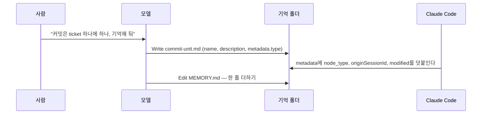

# 원래 auto memory의 동작

auto memory는 저장소마다 기억 폴더 하나에 색인 `MEMORY.md`와 주제 파일을 두고, 세션 시작에는 색인의 앞부분만 싣고, 쓰기와 읽기는 모델이 평범한 파일 도구로 한다.

이 글은 [Claude Code 동작](../claude-code.md)의 셋째 글이다. 한 사이클을 돌린 거친 도구는 auto memory를 끄고 그 자리에 붙었다.

> **예시** — auto memory를 켠 채로 이 저장소에서 세션을 열고 "커밋은 ticket 하나에 하나로 올린다, 기억해 둬"라고 한다. 다음 날 새 세션에서 "커밋 어떻게 나눠?"라고 묻는다.

## 기억은 저장소마다 폴더 하나에 있다

```text
~/.claude/projects/
└── -home-me-work-my-repo/       ← 저장소 경로 /home/me/work/my-repo에서 지은 이름
    └── memory/
        ├── MEMORY.md                 색인. 한 줄에 기억 하나
        │     - [커밋 단위](commit-unit.md) — ticket 하나에 하나
        └── commit-unit.md            주제 파일. 기억 하나
```

예시의 기억은 이 저장소의 폴더에만 생긴다. 같은 저장소의 하위 폴더와 worktree는 이 폴더를 같이 쓰고, 다른 저장소에서 연 세션은 이것을 보지 못한다.

| 경우 | 쓰는 폴더 |
|---|---|
| git 저장소의 root나 하위 폴더 | 저장소 하나에 폴더 하나 |
| git 밖의 폴더 | 세션을 연 폴더마다 따로 |
| user settings에 `autoMemoryDirectory` | 모든 저장소가 그 폴더 하나 |
| 저장소의 `.claude/settings.json`에 `autoMemoryDirectory` | 문서는 저장소가 주는 settings 파일이 고른 폴더에서는 auto memory를 load하지도 save하지도 않는다고 적는다. 실제로는 보지 않았다 |

확인: 2.1.325의 실제 세션에서 봤다. 폴더 이름은 저장소 경로의 영문과 숫자가 아닌 글자를 `-`로 바꾼 것이고, 세션 시작에 Claude Code가 알리는 기억 폴더의 경로와 맞았다. 문서는 이 폴더가 기기 안에만 있다고 적는다.

## 세션 시작에는 색인의 앞부분만 싣는다

```text
첫 API 요청
├── system prompt   `# Memory` 절 — 기억 폴더의 경로, 무엇을 언제 어떻게 쓰는지 (본 세션에서 2,287자)
└── user 메시지     <system-reminder> … Contents of <기억 폴더>/MEMORY.md:
                      - [커밋 단위](commit-unit.md) — ticket 하나에 하나
                    (주제 파일 commit-unit.md의 본문은 싣지 않는다)
```

다음 날 "커밋 어떻게 나눠?"라고 물으면 모델은 색인의 한 줄을 보고 `commit-unit.md`를 `Read`로 읽는다. 색인에 없는 주제 파일에 닿는 물음에는 모른다고 답했다.

| 걸리는 것 | 본 것 |
|---|---|
| 색인의 상한 | 앞 200줄과 앞 25,000자 가운데 먼저 닿는 데까지. 넘으면 잘리고 경고가 붙는다. 문서는 25KB, 경고 글은 24.4KB라고 적는다 |
| 색인이 드는 자리 | 첫 user 메시지. 문서 가운데 하나는 system prompt에 든다고 적는다 |
| 화면 | load했다는 줄은 뜨지 않는다. `/context`는 개수와 token 수만 보인다 |

확인: 2.1.325의 실제 세션에서 봤다. 상한은 ASCII와 한글로 경계를 재서, byte가 아니라 글자 수로 센다는 것을 확인했다.

## 쓰기는 모델이 고른다



예시의 "기억해 둬"는 이렇게 파일 둘을 바꾼다. 전용 도구는 없고, Claude Code가 하는 일은 frontmatter에 쓴 세션(`originSessionId`)과 시각(`modified`)과 `node_type`을 덧붙이는 것뿐이다. `node_type`의 뜻은 문서에 없다.

| 경우 | 본 것 |
|---|---|
| "기억해 둬" | 주제 파일을 만들고 색인에 한 줄을 더했다 |
| 이미 있는 사실을 "기억해 둬" | 주제 파일을 읽고 새로 쓰지 않았다 |
| 지나가듯 말한 사실 | 대화형 세 번 가운데 한 번 쓰였고, `claude -p`에서는 세 번 모두 쓰이지 않았다 |
| 다시 `Edit`으로 고치면 | `modified`는 고친 시각으로 바뀌고 `originSessionId`는 처음 쓴 세션에 머문다 |

확인: 2.1.325. 문서는 종류를 frontmatter의 `type`에 적는다고 하지만, 실제로는 `metadata` 아래의 `type`에 있었다.

## 낡은 기억은 모델이 찾아서 고친다

```text
"결제 샌드박스 주소가 바뀌었다, 고쳐"
  기억 24개 가운데 옛 주소가 든 파일 둘
  ├── payment-staging-endpoint.md   3번 모두 찾아 고침
  └── release-checklist.md          1번만 고침
        고친 run   : `결제`로 Grep
        놓친 run 둘: `sandbox|샌드박스`로만 Grep
```

고치는 길이 따로 없어서, 모델이 무엇으로 찾느냐가 결과를 정한다. 기억 4개에 사람이 기억의 낱말 그대로 말한 경우는 다섯 번 모두 고쳤다.

확인: 2.1.325의 `claude -p`(Sonnet 5.5)에서 돌렸다.

## 끄면 꺼지는 것과 남는 것

```text
끄는 길      user settings의 autoMemoryEnabled: false
             환경 변수 CLAUDE_CODE_DISABLE_AUTO_MEMORY=1
             /memory의 toggle  → user settings에 false를 쓴다

꺼지는 것    `# Memory` 절, 색인, 기억 폴더의 경로 (새 세션부터)
남는 것      기억 파일 — 지우지 않는다
             기억 폴더의 md에 대한 권한 예외 — 여전히 묻지 않고 읽고 쓴다
```

예시의 세션 도중에 toggle로 끄면 그 대화에는 걸리지 않는다. 다음 요청에도 `# Memory` 절과 색인이 그대로 있었고, "기억해 둬"에 모델은 그대로 기억 폴더에 썼다.

확인: 2.1.325. 두 끄는 길로 끈 세션의 system prompt는 한 줄도 다르지 않았다. 문서는 끄면 Claude가 그 폴더를 읽지도 쓰지도 않는다고 적지만, 권한은 막히지 않았다.

## 사람에게 보이지 않는 것

| 알고 싶은 것 | auto memory에서 |
|---|---|
| 언제 쓰였나 | 주제 파일의 `modified`에만 있다. 색인에는 없다 |
| 왜 쓰였나 | 남지 않는다 |
| 이번 세션에 무엇이 실렸나 | 화면에 뜨지 않는다. `/context`는 개수만 보인다 |
| 무엇을 읽었나 | 화면의 `Recalled 1 memory` 줄로만 보인다 |
| recall과 extraction | changelog에 나오는 동작의 이름이고, 무엇을 언제 하는지는 문서에 없다. 돌린 조건에서는 보이지 않았다 |

이 도구가 고치려는 불편이 이 표의 칸이다.

## 다시 조사할 때

| 절 | 볼 공식 문서 | changelog에서 찾을 낱말 |
|---|---|---|
| 폴더의 자리 | `memory.md`, `claude-directory.md` | `autoMemoryDirectory`, `memory` |
| 세션 시작의 load | `memory.md`, `context-window.md` | `MEMORY.md`, `200`, `25KB` |
| 쓰기 | `memory.md` | `auto memory`, `modified` |
| 끄기 | `memory.md`, `settings-reference.md` | `autoMemoryEnabled`, `DISABLE_AUTO_MEMORY` |
| recall과 extraction | `memory.md` | `recall`, `extract` |

실제 세션은 2.1.325에서 돌렸고, 공식 문서는 `https://code.claude.com/docs/en/<이름>`에서 2026-11-22(그때 changelog 맨 위 2.1.330)에 마지막으로 읽었다. 실제 동작을 다시 보는 법은 [Claude Code 동작](../claude-code.md)의 #다시 확인하는 법에 있다.
