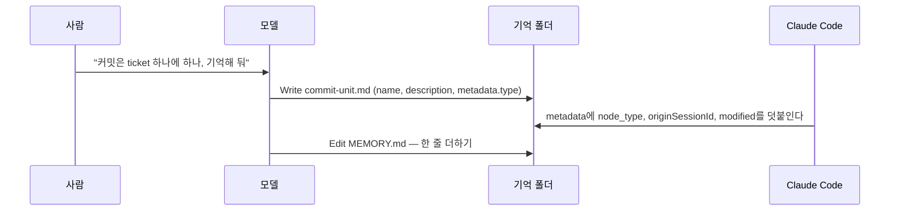

# 원래 auto memory의 동작

auto memory는 저장소마다 기억 폴더 하나에 색인 `MEMORY.md`와 주제 파일을 두고, 세션 시작에는 색인의 앞부분만 싣고, 쓰기와 읽기는 모델이 평범한 파일 도구로 한다.

이 글은 [Claude Code 동작](../claude-code.md)의 셋째 글이다. 한 사이클을 돌린 거친 도구는 auto memory를 끄고 그 자리에 붙었고, 지금 제품인 얹는 제품은 auto memory를 켠 채 그 위에 붙는다.

> **예시** — auto memory를 켠 채로 이 저장소에서 세션을 열고 "커밋은 ticket 하나에 하나로 올린다, 기억해 둬"라고 한다. 다음 날 새 세션에서 "커밋 어떻게 나눠?"라고 묻는다.

## 기억은 저장소마다 폴더 하나에 있다

```text
~/.claude/projects/
└── -home-me-work-my-repo/       ← 저장소 경로 /home/me/work/my-repo에서 지은 이름
    └── memory/
        ├── MEMORY.md                 색인. 한 줄에 기억 하나
        │     - [커밋 단위](commit-unit.md) — ticket 하나에 하나
        └── commit-unit.md            주제 파일. 기억 하나
```

예시의 기억은 이 저장소의 폴더에만 생긴다. 같은 저장소의 하위 폴더와 worktree는 이 폴더를 같이 쓰고, 다른 저장소에서 연 세션은 이것을 보지 못한다.

| 경우 | 쓰는 폴더 |
|---|---|
| git 저장소의 root나 하위 폴더 | 저장소 하나에 폴더 하나 |
| git 밖의 폴더 | 세션을 연 폴더마다 따로 |
| user settings에 `autoMemoryDirectory` | 모든 저장소가 그 폴더 하나 |
| 저장소의 `.claude/settings.json`에 `autoMemoryDirectory` | 문서는 저장소가 주는 settings 파일이 고른 폴더에서는 auto memory를 load하지도 save하지도 않는다고 적는다. 실제로는 보지 않았다 |

확인: 2.1.325의 실제 세션에서 봤다. 폴더 이름은 저장소 경로의 영문과 숫자가 아닌 글자를 `-`로 바꾼 것이고, 세션 시작에 Claude Code가 알리는 기억 폴더의 경로와 맞았다. 문서는 이 폴더가 기기 안에만 있다고 적는다.

## 세션 시작에는 색인의 앞부분만 싣는다

```text
첫 API 요청
├── system prompt   `# Memory` 절 — 기억 폴더의 경로, 무엇을 언제 어떻게 쓰는지 (본 세션에서 2,287자)
└── user 메시지     <system-reminder> … Contents of <기억 폴더>/MEMORY.md:
                      - [커밋 단위](commit-unit.md) — ticket 하나에 하나
                    (주제 파일 commit-unit.md의 본문은 싣지 않는다)
```

다음 날 "커밋 어떻게 나눠?"라고 물으면 모델은 색인의 한 줄을 보고 `commit-unit.md`를 `Read`로 읽는다. 색인에 없는 주제 파일에 닿는 물음에는 모른다고 답했다.

| 걸리는 것 | 본 것 |
|---|---|
| 색인의 상한 | 앞 200줄과 앞 25,000자 가운데 먼저 닿는 데까지. 넘으면 잘리고 경고가 붙는다. 문서는 25KB, 경고 글은 24.4KB라고 적는다 |
| 색인이 드는 자리 | 첫 user 메시지. 문서 가운데 하나는 system prompt에 든다고 적는다 |
| 화면 | load했다는 줄은 뜨지 않는다. `/context`는 개수와 token 수만 보인다 |

확인: 2.1.325의 실제 세션에서 봤다. 상한은 ASCII와 한글로 경계를 재서, byte가 아니라 글자 수로 센다는 것을 확인했다.

## 쓰기는 모델이 고른다



예시의 "기억해 둬"는 이렇게 파일 둘을 바꾼다. 전용 도구는 없고, Claude Code가 하는 일은 frontmatter에 쓴 세션(`originSessionId`)과 시각(`modified`)과 `node_type`을 덧붙이는 것뿐이다. `node_type`의 뜻은 문서에 없다.

| 경우 | 본 것 |
|---|---|
| "기억해 둬" | 주제 파일을 만들고 색인에 한 줄을 더했다 |
| 이미 있는 사실을 "기억해 둬" | 주제 파일을 읽고 새로 쓰지 않았다 |
| 지나가듯 말한 사실 | 대화형 세 번 가운데 한 번 쓰였고, `claude -p`에서는 세 번 모두 쓰이지 않았다 |
| 다시 `Edit`으로 고치면 | `modified`는 고친 시각으로 바뀌고 `originSessionId`는 처음 쓴 세션에 머문다 |

확인: 2.1.325. 문서는 종류를 frontmatter의 `type`에 적는다고 하지만, 실제로는 `metadata` 아래의 `type`에 있었다.

## 낡은 기억은 모델이 찾아서 고친다

```text
"결제 샌드박스 주소가 바뀌었다, 고쳐"
  기억 24개 가운데 옛 주소가 든 파일 둘
  ├── payment-staging-endpoint.md   3번 모두 찾아 고침
  └── release-checklist.md          1번만 고침
        고친 run   : `결제`로 Grep
        놓친 run 둘: `sandbox|샌드박스`로만 Grep
```

고치는 길이 따로 없어서, 모델이 무엇으로 찾느냐가 결과를 정한다. 기억 4개에 사람이 기억의 낱말 그대로 말한 경우는 다섯 번 모두 고쳤다.

확인: 2.1.325의 `claude -p`(Sonnet 5.5)에서 돌렸다.

## 끄면 꺼지는 것과 남는 것

```text
끄는 길      user settings의 autoMemoryEnabled: false
             환경 변수 CLAUDE_CODE_DISABLE_AUTO_MEMORY=1
             /memory의 toggle  → user settings에 false를 쓴다

꺼지는 것    `# Memory` 절, 색인, 기억 폴더의 경로 (새 세션부터)
남는 것      기억 파일 — 지우지 않는다
             기억 폴더의 md에 대한 권한 예외 — 여전히 묻지 않고 읽고 쓴다
```

예시의 세션 도중에 toggle로 끄면 그 대화에는 걸리지 않는다. 다음 요청에도 `# Memory` 절과 색인이 그대로 있었고, "기억해 둬"에 모델은 그대로 기억 폴더에 썼다.

확인: 2.1.325. 두 끄는 길로 끈 세션의 system prompt는 한 줄도 다르지 않았다. 문서는 끄면 Claude가 그 폴더를 읽지도 쓰지도 않는다고 적지만, 권한은 막히지 않았다.

## 2.1.332에서 다시 본 것

테스트셋을 기준선에 돌리며 본 것이다. 위 절들의 관찰은 2.1.325의 것이고, 여기에는 그 뒤에 달라졌거나 새로 본 것을 적는다.

| 무엇 | 본 것 |
|---|---|
| 색인이 잘릴 때 | 색인 250줄 가운데 200줄만 실리고, 그 끝에 모델에게 가는 경고가 붙는다. 경고는 몇 줄이 잘렸고 어느 줄부터 잘렸는지를 적는다. 실린 글은 경고까지 18,083자였다 |
| 색인에서 잘린 기억 | 사람의 말에 든 낱말이 잘린 기억의 파일과 겹치면, 모델이 기억 폴더를 `grep`해서 그 파일을 읽었다. 시험 둘에서 세 번씩, 여섯 번 모두다 |
| 지나가듯 한 말 | 한 세션에서 세 번 되풀이한 말("그 테스트는 깨져 있어, 건너뛰어")은 세 번 모두 기억으로 쓰였다. 가정으로 한 질문, 예시로 든 문장, 남의 말, 이번만이라고 한 말은 기억이 되지 않았다 |
| 고칠 때 | 새 값으로 고치고 옛 값을 본문에 내력으로 남긴다("54329에서 바뀜"). 기억의 낱말 그대로 말한 경우는 세 번 모두 고쳤고, 다른 낱말로 적힌 둘째 파일은 세 번 모두 놓쳤다. 사람이 그 값을 기억에 적힌 이름과 다른 이름으로 부른 경우는 2026-11-26에 여섯 번 더 돌렸다. 처음 세 번까지 아홉 번 가운데 다섯은 첫 파일만 고쳤고, 셋은 어느 기억인지 사람에게 묻고 아무것도 고치지 않았고, 하나는 옛 기억을 그대로 둔 채 새 이름의 기억을 따로 만들었다. 둘째 파일을 고친 run은 없다 |
| 낡았거나 맞지 않는 기억 | 그대로 따르지 않았다. 답에 그 기억을 꺼내 놓은 뒤 적용하지 않겠다고 하거나 사람에게 되물었다. 근거 파일이 사라진 기억, 14일 전에 "이번 주"라고 적은 기억, 다른 일의 규정에서 세 번씩 봤다 |
| 시키지 않은 고침 | 위 아홉 run 가운데 기억 폴더의 앞뒤를 견준 여섯에서, 하나는 사람이 고치라고 하지 않았는데 모델이 그 기억을 고쳐 썼다. "이번 주는 배포 동결이다"를 날짜를 어림한 풀이로 바꾸고, 답에서 고쳤다고 알렸다. 나머지 다섯은 기억 폴더가 그대로였다 |
| 다른 저장소의 기억 | 실리지 않는다. 찾아 달라고 하자 모델이 다른 저장소의 기억 폴더를 열려 했고, `claude -p`에서는 거부됐다 |
| 세션을 넘기는 말 | "나머지는 다음 세션에서 이어서 하자"고 하면 남은 일을 기억으로 쓰고, 다음 세션이 그 일을 끝낸 뒤 그 기억을 지웠다. 세 번 모두다 |
| 응답 언어 | settings에 `language`가 없으면 한국어 말에 영어로 답하거나 기억을 영어로 쓰는 run이 있었다 |

아래는 같은 날 잰 값이다.

| 잰 것 | 값 |
|---|---|
| 기억이 첫 요청에서 차지한 token | 11,568 token이고 첫 요청의 35%다. 기억 250개를 둔 저장소에서 기억을 켠 첫 요청이 33,060 token, 끈 첫 요청이 21,492 token이었다 |
| 글자와 token | 위 차이를 실린 색인 18,083자로만 나누면 token 하나가 1.6자다. 차이에는 `# Memory` 절도 들어 있고 그 절의 길이는 이번에 재지 않아서, 실제 값은 1.6자보다 크다 |
| cache | 같은 세션을 `--resume`으로 이어 부른 서른 번에서, 둘째 호출부터 cache에 새로 쓴 몫은 3천 token 안팎이고 나머지는 cache에서 읽었다 |
| 호출 하나의 시간 | `claude -p` 244번의 중앙값이 8.4초, 가장 긴 것이 53초였다 |
| hook process | Python으로 쓴 `PreToolUse` hook 하나가 뜨고 끝나는 데 중앙값 16ms였다. Claude Code 밖에서 hook만 30번 띄워 쟀다 |

확인: 2026-11-25, Claude Code 2.1.332, `claude -p`, Sonnet 5.5, 응답 언어 한국어. 시험마다 세 번 돌렸다. 다른 모델은 보지 않았다. 구독의 사용 한도에 얼마로 잡히는지도 재지 못했다.

아래는 같은 날 대화형 세션의 사람 화면에서 본 것이다.

| 무엇 | 본 것 |
|---|---|
| 세션의 첫 화면 | 기억에 관한 줄이 없다. 기억 10개를 둔 저장소와 250개를 둔 저장소에서 같았고, 접힌 알림을 펼쳐도 없었다. 색인이 잘렸다는 경고는 모델에게만 가고 사람 화면에는 뜨지 않았다 |
| 기억 파일을 읽을 때 | 답 위의 접힌 줄에 `recalled 1 memory`가 뜬다. `ctrl+o`로 펼치면 읽은 파일의 경로가 보인다 |
| 기억을 쓸 때 | 접힌 줄에 `wrote 2 memories`가 뜬다. 주제 파일과 색인을 센 것이다. 펼치면 쓴 파일의 경로와 내용이 보이고, 모델은 답에도 기억에 적었다고 말했다 |
| 새로 쓴 기억의 본문 | 여섯 가운데 여섯이 `**Why:**` 줄에 사람이 시켰다는 것을 적었다. Claude Code가 남기는 칸이 아니라 모델이 쓴 글이다 |
| 고쳐 달라는 말 | 제자리에서 고친 세션과, 옛 주제 파일을 지우고 새 이름의 파일을 만든 세션이 있었다. 뒤의 경우 옛 파일의 `modified`와 `originSessionId`가 함께 사라졌고, 옛 값은 새 파일의 본문에 한 줄로 남았다 |
| 이 기기의 기억을 모두 보여 달라는 말 | 모델이 다른 저장소의 기억 폴더를 읽겠다고 물었고, 허락하자 저장소 셋의 기억을 한 답에 모았다. 명령마다 묻는 권한 모드에서 세 번 물었다 |
| `/memory` | auto memory의 켬과 끔, 지시 파일 둘, 기억 폴더를 여는 항목이 뜬다. 기억의 목록은 뜨지 않는다 |
| hook | 기억 파일의 `Read`와 `Write`는 `PreToolUse` hook에 잡혔다. 색인을 `sed`로 고치거나 주제 파일을 `rm`으로 지운 것은 `Bash` 호출로 잡혔다 |
| 권한 모드 | 처음 쓰는 HOME에서 연 대화형 세션은 auto mode로 떴다 |

확인: 2026-11-25, Claude Code 2.1.332, 대화형 세션, Sonnet 5.5. 테스트셋의 장면 여섯을 한 번씩 돌리고 터미널 화면을 글자로 떠서 읽었다. 색은 보지 않았다.

## 사람에게 보이지 않는 것

| 알고 싶은 것 | auto memory에서 |
|---|---|
| 언제 쓰였나 | 주제 파일의 `modified`에만 있다. 색인에는 없다. 고치면 고친 시각으로 덮이고, 파일을 지우고 새로 만들면 처음 쓴 세션도 사라진다 |
| 왜 쓰였나 | Claude Code가 남기는 칸은 없다. 2.1.332에서 모델이 새로 쓴 기억은 본문에 사람이 시켰다는 한 줄을 적었다 |
| 이번 세션에 무엇이 실렸나 | 화면에 뜨지 않는다. `/context`는 개수만 보인다. 색인이 잘려도 사람 화면에는 알리지 않는다 |
| 무엇을 읽었나 | 화면의 `recalled 1 memory` 줄로 개수가 보이고, 펼치면 파일의 경로가 보인다 |
| recall과 extraction | changelog에 나오는 동작의 이름이고, 무엇을 언제 하는지는 문서에 없다. 돌린 조건에서는 보이지 않았다 |

이 도구가 고치려는 불편이 이 표의 칸이다.

## 다시 조사할 때

| 절 | 볼 공식 문서 | changelog에서 찾을 낱말 |
|---|---|---|
| 폴더의 자리 | `memory.md`, `claude-directory.md` | `autoMemoryDirectory`, `memory` |
| 세션 시작의 load | `memory.md`, `context-window.md` | `MEMORY.md`, `200`, `25KB` |
| 쓰기 | `memory.md` | `auto memory`, `modified` |
| 끄기 | `memory.md`, `settings-reference.md` | `autoMemoryEnabled`, `DISABLE_AUTO_MEMORY` |
| recall과 extraction | `memory.md` | `recall`, `extract` |

실제 세션은 2.1.325에서 돌렸고(다시 본 것 절은 2.1.332이고 `claude -p`와 대화형 세션 둘 다다), 공식 문서는 `https://code.claude.com/docs/en/<이름>`에서 2026-11-22(그때 changelog 맨 위 2.1.330)에 마지막으로 읽었다. 실제 동작을 다시 보는 법은 [Claude Code 동작](../claude-code.md)의 #다시 확인하는 법에 있다.
