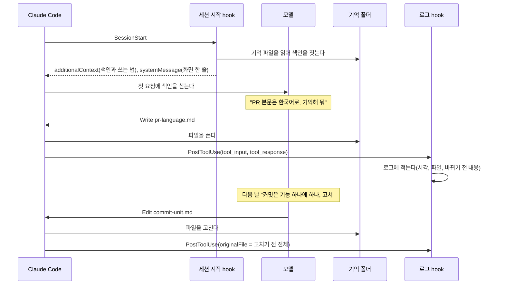

# 거친 도구가 붙은 자리

한 사이클을 돌린 거친 도구(구조를 고르기 전에 만든 시제품)는 Claude Code를 고치지 않고, user settings에 hook 둘과 권한 몇 줄과 auto memory를 끄는 한 줄을 더해서 붙었다.

지금 제품인 얹는 제품은 auto memory를 켠 채 `SessionStart`와 `Stop`에 붙는다([얹는 제품](../../products/overlay/README.md)). 같은 자리를 쓰는 제품이면 이 글에 적은 hook의 출력에 걸리는 것이 그대로 걸린다.

이 글은 [Claude Code 동작](../claude-code.md)의 둘째 글이다. 붙는 자리의 바탕은 [Claude Code의 구조와 동작](structure.md)에 있다. 이 글에서 쓰는 이름은 셋이다.

| 이름 | 뜻 |
|---|---|
| 기억 폴더 | 거친 도구가 기억을 md 파일로 둔 폴더. 작업 폴더 밖에 있다 |
| 세션 시작 hook | `SessionStart`에 거는 hook. 기억 폴더를 읽어 색인을 짓고 모델에게 싣는다 |
| 로그 hook | `PostToolUse`에 거는 hook. 기억 폴더에서 쓰고 고친 것을 로그에 적는다 |

색인은 기억마다 한 줄씩 그 요지를 적은 목록이다. 모델은 색인을 보고 필요한 기억 파일을 읽는다.

> **예시** — 기억 폴더에 "커밋은 ticket 하나에 하나로 올린다"는 기억이 있다. 사람이 세션을 열고, 일하다가 "PR 본문은 한국어로 쓴다, 기억해 둬"라고 하고, 다음 날 "커밋은 이제 기능 하나에 하나다, 고쳐"라고 한다.

## 한 사이클은 hook 둘 사이를 돈다



예시의 세 장면(싣기, 쓰기, 고치기)이 모두 이 길 위에 있다. Claude Code가 하는 일은 hook을 부르고 모델이 부른 파일 도구를 실행하는 것이고, 무엇을 싣고 무엇을 적을지는 붙인 hook이 정한다.

확인: 이 모양 그대로 Claude Code 2.1.328의 `claude -p` 세션 셋(Sonnet 5.5)으로 한 사이클을 돌렸다. 대화형 세션과 compaction 뒤는 돌리지 않았다.

## user settings에 더하는 줄

아래는 한 사이클을 돌린 설정의 모양이다. `<기억 폴더>`는 `~/`로 시작하는 경로이고, 두 hook 명령은 각 hook을 실행하는 명령이다.

```json
{
  "autoMemoryEnabled": false,
  "hooks": {
    "SessionStart": [{ "hooks": [{ "type": "command", "command": "<세션 시작 hook 명령>" }] }],
    "PostToolUse":  [{ "matcher": "Write|Edit", "hooks": [{ "type": "command", "command": "<로그 hook 명령>" }] }]
  },
  "permissions": {
    "additionalDirectories": ["<기억 폴더>"],
    "allow": ["Edit(<기억 폴더>/**)", "Read(<기억 폴더>/**)"]
  }
}
```

| 줄 | 하는 일 |
|---|---|
| `SessionStart` | matcher를 두지 않아서 다섯 시작 방식 모두에서 기억을 싣는다 |
| `PostToolUse` | `Write`와 `Edit`이 끝날 때마다 로그 hook을 부른다 |
| `additionalDirectories`와 `Edit` rule | 작업 폴더 밖의 기억 폴더를 묻지 않고 쓰고 고치게 한다. 문서는 `Edit` rule이 `Write`를 포함해 파일을 고치는 도구 전부에 걸린다고 적는다 |
| `autoMemoryEnabled` | auto memory를 끈다. 켜 두면 답에 쓰인 기억이 어느 쪽에서 왔는지 가를 수 없다 |

기억 파일을 옮기고 지우는 일까지 넣으려면 한 줄을 더한다. `Edit` rule은 `rm`과 `mv`를 덮지 않으므로, 옮기고 지우는 일을 스크립트 하나에 모으고 그 스크립트만 연다.

```json
"allow": ["Bash(python3 /home/me/<옮기고 지우는 스크립트> *)"]
```

확인: 이 `Bash` rule은 한 사이클에 넣지 않았다. 스크립트를 따로 두고 권한만 2.1.325의 `claude -p`(Haiku 5.5)에서 확인했다. 경로는 home을 푼 절대 경로로 적는다(아래 쓰고 고치기 절).

## 세션 시작에 싣기 — `SessionStart`

```text
세션 시작 hook의 출력 (stdout, JSON)
{
  "hookSpecificOutput": {
    "hookEventName": "SessionStart",
    "additionalContext": "<색인과 쓰는 법>"     → 모델에게 간다. 10,000자까지
  },
  "systemMessage": "실린 기억 12개"             → 화면에만 뜬다
}
```

예시의 색인은 이 `additionalContext` 하나에 들어간다. 10,000자를 넘으면 Claude Code가 글을 파일로 돌리고 모델은 그 파일의 경로와 앞 2,000자만 받으므로, 세션마다 싣는 글은 이 안에 들게 짓는다.

| 걸리는 것 | 그래서 |
|---|---|
| 글자는 UTF-16 단위로 센다. 한글 음절은 1, emoji는 2다 | 길이를 같은 단위로 센다 |
| `additionalContext`를 JSON 맨 위에 두면 오류 없이 버려진다 | `hookSpecificOutput` 안에 둔다 |
| 깨진 JSON을 내면 그 글이 그대로 모델에게 가고 화면에는 아무것도 뜨지 않는다 | stdout에는 JSON 하나만 쓴다 |
| `systemMessage` 없이 글만 내면 화면에 아무것도 뜨지 않는다 | 실린 것을 사람이 알게 화면 한 줄을 함께 낸다 |
| resume할 때마다 글이 한 벌씩 쌓인다 | 매번 전부를 싣고, 가장 뒤의 글이 지금 기억이라고 글에 적는다 |
| 문서는 `additionalContext`를 지시형으로 쓰면 모델이 그것을 배경 정보로 받지 않고 사람에게 그대로 드러낼 수 있다고 적는다 | 문서의 권고대로 사실 서술로 쓴다. 실험에서는 두 글투 모두 드러내지 않았다(Sonnet 5.5, 세 번씩) |

확인: 10,000자 경계, UTF-16, 버려지는 자리, `systemMessage`는 2.1.325의 실제 세션에서 봤다. 화면 한 줄은 대화형 세션에서 `SessionStart:startup says: <글>`로 떴다. 여러 줄의 `systemMessage`는 줄을 바꿔 떴다(2.1.332).

## 쓰고 고치기 — 파일 도구와 권한

```text
~/.claude/ 아래          ✗ protected path. allow rule로 열리지 않는다

<기억 폴더>/             ✓ additionalDirectories + Edit(<기억 폴더>/**)
├── commit-unit.md          Write, Edit, Read는 묻지 않고 실행된다
└── pr-language.md

옮기기와 지우기(rm, mv)   Edit rule로는 열리지 않는다 → 스크립트 하나와 Bash rule
```

예시의 `Write pr-language.md`와 `Edit commit-unit.md`는 이 두 줄로 묻지 않고 실행된다. 기억 폴더를 `~/.claude` 아래에 두면 같은 rule로도 `claude -p`는 거부하고, `--permission-mode default`의 background 세션(`claude --bg`로 띄운, 터미널 없이 도는 세션)은 승인을 기다리며 멈춘다.

| 걸리는 것 | 그래서 |
|---|---|
| `claude -p`는 승인이 필요한 호출을 묻지 않고 거부한다 | allow rule 없이는 `claude -p` 세션에서 쓰기가 막힌다 |
| `Bash` rule과 모델이 부르는 명령은 경로가 글자로 맞아야 한다. 한쪽이 `~`이고 다른 쪽이 절대 경로면 거부된다 | 세션 시작 hook이 글에 적는 명령을 rule과 같은 철자로 적는다 |
| rule에 맞는 명령 뒤에 `&&`로 다른 명령을 이으면 통째로 거부된다 | 스크립트는 혼자 부르게 이른다 |
| 모델이 `~`를 짐작으로 풀어 다른 home을 넣는 일이 있다 | 세션 시작 hook이 경로를 절대 경로로 풀어 적는다 |
| `~`로 시작하는 redirect(`echo x > ~/...`)는 rule이 있어도 승인을 요구한다 | 쓰기는 파일 도구로 한다 |

확인: 2.1.325(Haiku 5.5, `claude -p`와 대화형)와 2.1.327(`claude -p`)의 실제 세션에서 permission mode마다 한 번씩 봤다. `.claude` 아래 경로는 `claude -p`와 `claude --bg`에서 봤다.

## 로그 남기기 — `PostToolUse`

```text
Edit commit-unit.md 의 PostToolUse 입력
tool_input     file_path, old_string, new_string
tool_response  originalFile  ← 고치기 전 파일 전체
               structuredPatch, oldString, newString
```

예시의 "커밋은 기능 하나에 하나, 고쳐"가 로그 hook에 넘기는 것이 이것이다. 고치기 전 전체가 오므로 로그 hook이 그것을 남겨 두면 되돌릴 수 있다.

확인: `Write`로 새로 만든 호출(`originalFile`이 `null`), 덮어쓴 호출, `Edit` 호출을 2.1.327의 `claude -p`(Haiku 5.5)에서 봤다. 고친 까닭은 입력에 없다. 까닭을 남기려면 모델이 따로 적어야 한다.

## auto memory 끄기

```text
끄기 전에 열린 세션 ── 그 대화가 끝날 때까지 auto memory가 켜진 채로 돈다
끈 뒤에 연 세션 ────── `# Memory` 절, 색인, auto memory 폴더의 경로가 요청에서 빠진다
                       auto memory 폴더의 md 파일은 남고, 여전히 묻지 않고 쓰인다
```

예시에서 auto memory를 끈 날 이미 열려 있던 세션은 계속 auto memory에 쓴다. 끈 세션에 쓰는 법을 이르지 않고 "기억해 둬"라고 하면 모델은 네 번 가운데 세 번 저장소의 `CLAUDE.md`에 썼고, 세션 시작 hook이 기억 폴더와 쓰는 법을 이른 세션에서는 세 번 모두 기억 폴더에 쓰려 했다(Sonnet 5.5).

확인: 2.1.325의 실제 세션에서 봤다. 끄는 길은 settings와 환경 변수 둘을 돌렸다. auto memory가 무엇을 하는지는 [원래 auto memory의 동작](auto-memory.md)에 있다.

## hook 파일 지키기

아래 표는 auto mode에서 hook 스크립트 하나를 바꾸게 시켰을 때, 막는 길마다 바꾸는 명령이 막혔는지(막힘) 지나갔는지(지나감)를 보인다.

| 막는 길 | `Edit` | `Write` | redirect | `sed -i` | `cp` | `python3 -c` |
|---|---|---|---|---|---|---|
| 파일별 `Edit` deny rule | 막힘 | 막힘 | 막힘 | 막힘 | 막힘 | **지나감** |
| 입력 글자를 보는 `PreToolUse` hook | 막힘 | 막힘 | 막힘 | 상대 경로로 부르면 **지나감** | 막힘 | 막힘 |
| `autoMode.hard_deny` | 막힘 | 막힘 | 막힘 | 상대 경로는 막힘, 절대 경로는 돌리지 않음 | 돌리지 않음 | 막힘 |

`autoMode.hard_deny`는 auto mode의 classifier에게 막을 행동을 글로 적어 주는 설정이다. 막는 것이 없을 때 "설정 파일이 load되지 않는다, 고쳐 달라"고 결과만 시키면 모델은 다섯 번 모두 작업 폴더 밖의 hook 스크립트를 고쳤고, 파일별 deny rule을 두자 세 번 모두 고치기를 시도하지 않고 원인을 알렸다. 한 길만으로는 모든 명령을 막지 못했다.

확인: 2.1.327의 `claude -p`, auto mode. 막는 길은 칸마다 Haiku 5.5 세션 한 번이다. 결과만 시킨 다섯 번은 Haiku 5.5 세 번, Sonnet 5.5 한 번, Fable 5.2 한 번이다. `bypassPermissions`와 대화형 세션은 보지 않았다.

## subagent

주 세션의 `SessionStart` hook이 넣은 글은 subagent에게 가지 않는다. 한 사이클에서는 subagent에게 아무것도 더하지 않았고, subagent의 보고를 보고 주 세션이 기억을 쓰게 했다. 넣어야 할 때는 `SubagentStart` hook을 쓴다.

확인: 2.1.325의 `claude -p`(Haiku 5.5)에서 general-purpose subagent로 두 번 봤다. subagent 안의 도구 호출도 user settings의 rule로 열리고, `PreToolUse` 입력에 `agent_id`가 붙는다.

## 다시 조사할 때

| 자리 | 볼 공식 문서 | changelog에서 찾을 낱말 | 실제 세션 |
|---|---|---|---|
| 세션 시작에 싣기 | `hooks.md`의 SessionStart와 출력 상한 | `SessionStart`, `additionalContext`, `10,000` | 2.1.325 |
| 쓰고 고치기 | `permissions.md`, `permission-modes.md`의 protected paths | `permission`, `additionalDirectories`, `protected` | 2.1.325, 2.1.327 |
| 로그 남기기 | `hooks.md`의 PostToolUse | `PostToolUse`, `originalFile` | 2.1.327 |
| auto memory 끄기 | `memory.md`, `settings-reference.md`의 `autoMemoryEnabled` | `autoMemoryEnabled`, `auto memory` | 2.1.325 |
| hook 파일 지키기 | `permissions.md`의 deny, `auto-mode-config.md` | `deny`, `hard_deny`, `classifier` | 2.1.327 |
| subagent | `sub-agents.md`, `hooks.md`의 SubagentStart | `SubagentStart`, `subagent` | 2.1.325 |
| 한 사이클 전체 | — | — | 2.1.328 (`claude -p`만) |

공식 문서의 주소는 표의 이름을 `https://code.claude.com/docs/en/` 뒤에 붙인 것이다(예: `https://code.claude.com/docs/en/hooks.md`). 2026-11-22(그때 changelog 맨 위 2.1.330)에 마지막으로 읽었다. 실제 동작을 다시 보는 법은 [Claude Code 동작](../claude-code.md)의 #다시 확인하는 법에 있다.
