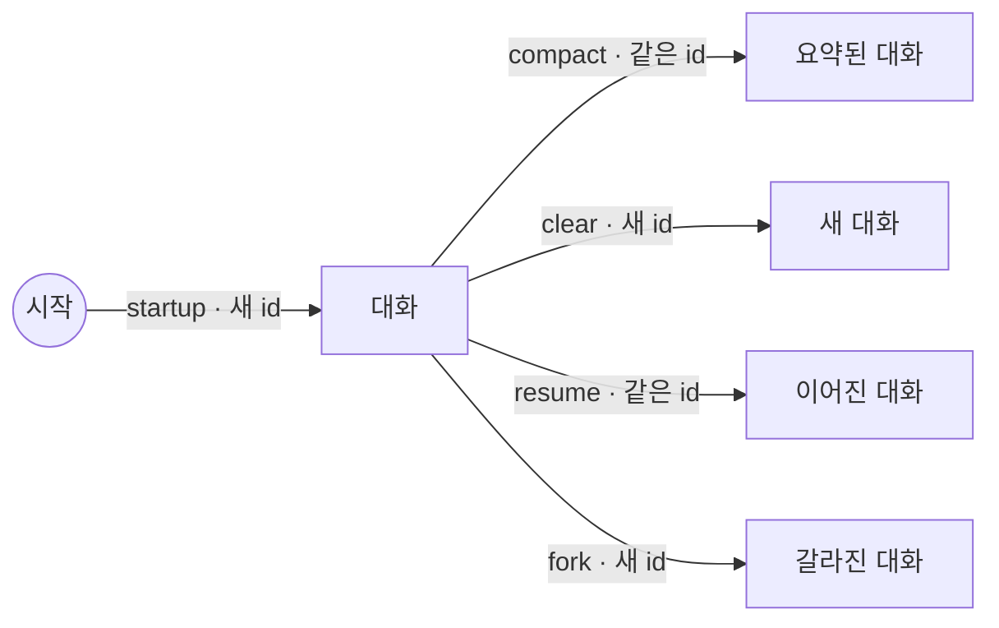
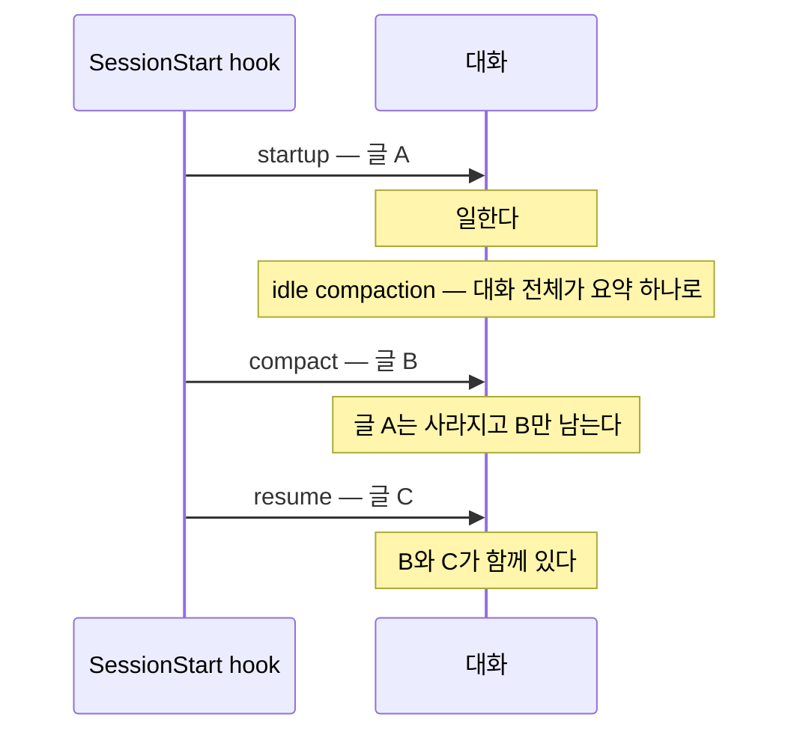
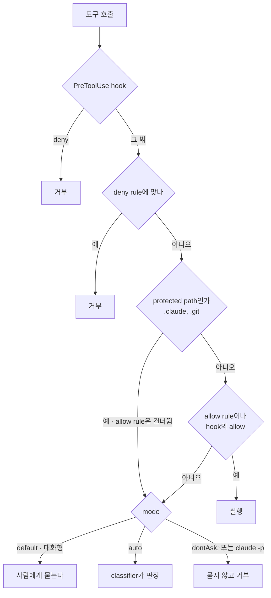

# Claude Code의 구조와 동작

Claude Code의 세션은 다섯 가지 방식으로 시작하고, 시작할 때마다 hook이 모델에게 글을 덧붙일 수 있으며, 대화는 덧붙기만 하다가 compaction이 오면 요약으로 바뀐다.

이 글은 [Claude Code 동작](../claude-code.md)의 첫째 글이다. 그림은 하나의 예시를 따라간다.

> **예시** — 저장소에서 `claude`를 열고 일하다가, 한 시간쯤 자리를 비운 뒤 돌아와 `claude --resume`으로 같은 세션을 다시 연다.

## 세션은 다섯 가지 방식으로 시작한다



예시의 세션은 `startup`으로 시작했고, 자리를 비운 사이 idle compaction(한 시간쯤 쉰 대화를 Claude Code가 스스로 요약하는 것)이 오면 `compact`, 다시 열면 `resume`이다. 다섯 방식 모두에서 `SessionStart` hook이 돌고, hook 입력의 `source`에 방식의 이름이 온다.

| 방식 | 일으키는 것 | `session_id` |
|---|---|---|
| `startup` | `claude`, `claude -p`, `claude --bg`(터미널 없이 도는 background 세션) | 새 값 |
| `clear` | `/clear` | 새 값 |
| `compact` | `/compact`, auto compaction, idle compaction, `/rewind`의 Summarize | 그대로 |
| `resume` | `--resume`, `--continue`, `/resume` | 그대로 |
| `fork` | `/fork`, `/branch`, `--fork-session` | 새 값 |

확인: 다섯 방식 모두 Claude Code 2.1.325의 실제 세션(대화형과 `claude -p`)에서 봤다. idle compaction은 Sonnet 5.5 세션에서만 일어났고 Haiku 5.5 세션에서는 일어나지 않았다. 까닭은 모른다.

## 모델이 받는 글은 층으로 쌓인다

```text
첫 API 요청
├── system prompt     Claude Code의 지시
│                     └ auto memory를 켜면 `# Memory` 절(기억 폴더의 경로와 쓰는 법)
├── user 메시지       <system-reminder>
│                     ├ CLAUDE.md의 내용
│                     └ auto memory의 색인 MEMORY.md
│                     + 사람의 첫 prompt
└── role이 system인 메시지
                      "SessionStart hook additional context: <hook이 넣은 글>"
```

예시의 첫 요청은 이 세 칸으로 이루어진다. CLAUDE.md와 auto memory 색인은 system prompt가 아니라 첫 user 메시지에 들고, hook이 넣은 글은 그 뒤의 role이 system인 메시지에 든다.

확인: 2.1.325의 실제 세션에서 transcript에 남은 API 요청 기록(`api-request`)을 읽었다. 공식 문서는 hook의 글이 system reminder로 감싸여 첫 prompt 앞에 놓인다고 적어서, 본 것과 다르다.

## 대화는 덧붙기만 하고, compaction이 그것을 요약으로 바꾼다



hook은 앞서 넣은 글을 지우지 못한다. 그래서 matcher 없이 건 hook은 resume할 때마다 글을 한 벌씩 더 쌓고, 쌓인 글은 다음 compaction에서야 요약 속으로 사라진다.

확인: `/compact`, auto compaction, idle compaction 뒤에 앞서 넣은 글이 따로 남지 않은 것을 2.1.325에서 봤다. idle compaction을 거친 세션을 resume한 뒤 compaction 때의 글과 resume 때의 글이 함께 있는 것은 세션 하나에서 봤다. 여러 벌 쌓인 뒤의 compaction은 보지 않았다.

## hook은 다섯 자리에서 끼어든다

```text
세션 시작      SessionStart        글을 넣는다(additionalContext), 화면에 한 줄(systemMessage)
도구 호출 전   PreToolUse          호출을 막거나(deny) 묻지 않게 한다(allow)
도구 호출 뒤   PostToolUse         무엇이 바뀌었는지 받는다(tool_input, tool_response)
subagent 시작  SubagentStart       subagent에게 글을 넣는다
지시 파일 load InstructionsLoaded  CLAUDE.md가 load될 때 돈다(MEMORY.md에는 돌지 않았다)
```

한 사이클을 돌린 거친 도구가 쓴 것은 세션 시작과 도구 호출 뒤다. hook은 사용자 권한으로 도는 프로그램이고 JSON으로 답한다.

| 자리 | 알아 둘 것 | 확인 |
|---|---|---|
| `SessionStart` | 글은 `hookSpecificOutput.additionalContext`에 둔다. JSON 맨 위에 두면 오류 없이 버려진다 | 실제 세션 |
| `SessionStart` | `additionalContext`가 10,000자를 넘으면 Claude Code가 글을 파일로 돌리고, 모델은 그 파일의 경로와 앞 2,000자만 받는다. 글자는 UTF-16 단위로 센다 | 실제 세션, 문서 |
| `SessionStart` | `systemMessage`는 화면에만 뜨고 모델에게 가지 않는다 | 실제 세션 |
| `PreToolUse` | `deny`는 auto mode에서도 막는다. 입력 글자만 보면 상대 경로 명령을 놓친다 | 실제 세션 |
| `PostToolUse` | `Write`와 `Edit`의 `tool_response.originalFile`에 바뀌기 전 파일 전체가 온다. 새 파일이면 `null`이다 | 실제 세션(2.1.327) |
| `SubagentStart` | 주 세션의 `SessionStart` 글은 subagent에 가지 않는다. 넣으려면 이 hook을 쓴다 | 실제 세션 |

## 도구 호출은 정해진 순서로 판정된다



permission mode의 `default`는 Manual이라 부르는 mode의 설정값이다. 문서는 v2.1.283부터 대화형 세션이 따로 정하지 않으면 auto mode로 시작하고, v2.1.302부터 mode를 정하지 않은 `claude -p`가 `default`로 시작한다고 적는다. 예시의 세션에서 작업 폴더 밖 파일을 쓰려면 allow rule이 있어야 하고, 그 파일이 `.claude` 아래에 있으면 allow rule로도 열리지 않는다.

확인: 순서는 공식 문서를 따라 그렸다. deny rule, allow rule, `.claude` 아래 경로, `claude -p`의 거부는 2.1.325와 2.1.327의 실제 세션에서 봤다. classifier가 무엇을 통과시키는지는 모델과 문장에 따라 달라서 정리하지 않았다.

## settings는 scope마다 겹친다

```text
높음  managed settings
  │   command line (--settings, --permission-mode)
  │   local     <저장소>/.claude/settings.local.json
  │   project   <저장소>/.claude/settings.json
낮음  user      ~/.claude/settings.json      ← 그 기기의 모든 저장소에 걸린다
```

한 사이클에서는 user settings에 줄을 두었다. 저장소의 settings가 같은 key를 다르게 두면 그쪽이 이긴다.

확인: 순서는 문서를 읽었다. local settings의 `autoMemoryEnabled: true`가 user settings의 `false`를 이기는 것은 2.1.325의 실제 세션에서 봤다.

## 글을 넣을 수 있는 hook 자리는 더 있다

```text
세션 시작        SessionStart       대화의 맨 앞, 첫 prompt 앞에 놓인다
사람의 말        UserPromptSubmit   그 prompt 곁에 놓인다
도구 호출 직전   PreToolUse         그 호출의 결과 곁에 놓인다
도구 호출 뒤     PostToolUse        그 호출의 결과 곁에 놓인다
답이 끝날 때     Stop               turn의 끝에 놓이고, 대화가 이어진다
```

예시의 세션에서는 사람이 말할 때마다, 모델이 도구를 부를 때마다 hook이 글을 더 넣을 수 있다. 넣는 글은 어느 자리에서나 `hookSpecificOutput.additionalContext`에 둔다.

| 알아 둘 것 | 문서가 적은 것 |
|---|---|
| `PreToolUse`가 넣은 글의 자리 | 호출 앞이 아니라 그 호출의 결과 곁이다. `permissionDecision`이 `defer`면 버려진다 |
| 10,000자 상한을 재는 단위 | 문자열 하나마다 따로 잰다. 같은 event에 hook 여럿이 돌아도 합쳐 재지 않는다. 올리는 설정은 없다 |
| 여러 hook과 여러 자리를 합친 상한 | 적혀 있지 않다 |

확인: 2026-11-25에 `hooks.md`를 읽었다(그때 changelog 맨 위 2.1.332). 실제 세션에서 글이 들어가는 것을 본 자리는 `SessionStart`와 `Stop`이다. `Stop`은 아래 #답이 끝날 때와 세션이 끝날 때의 확인 줄에 있다.

`PreToolUse`의 글이 결과 곁에 놓인다면 그 글은 그 호출을 바꾸지 못하고 다음 판단부터 닿는다고 끌어냈다. 호출보다 먼저 도는 hook의 글이 어떻게 결과 곁에 놓이는지는 문서에 없다.

## 답이 끝날 때와 세션이 끝날 때

```text
답 한 번이 끝남 ── Stop hook         사람이 끊은 답에는 돌지 않는다
                   └ async: true     Claude Code가 기다리지 않는다
세션이 끝남 ────── SessionEnd hook   기본 1.5초 안에 끝나야 하고, 끝나는 것을 막지 못한다
```

예시의 세션에서 `Stop`은 답이 끝날 때마다 돌고, `SessionEnd`는 세션이 끝날 때 돈다.

| 무엇 | 문서가 적은 것 |
|---|---|
| `Stop`이 도는 때 | 주 agent가 답을 마칠 때 돈다. 사람이 끊어서 멈춘 답에는 돌지 않고, API 오류로 멈추면 `StopFailure`가 대신 돈다 |
| `Stop`에서 모델에게 글 넣기 | `hookSpecificOutput.additionalContext`는 hook 오류가 아닌 feedback으로 들어가고, 모델이 그 글을 보고 움직일 수 있게 대화가 이어진다. `decision: "block"`도 대화를 잇지만 hook 오류로 표시된다 |
| `Stop`이 대화를 이을 때의 되풀이 막기 | 이미 `Stop` hook 때문에 이어지는 중이면 hook 입력의 `stop_hook_active`가 참이다. 연달아 여덟 번 이어지면 Claude Code가 다음 것을 무시하고 turn을 끝낸다. 이 수는 모델이 도구를 부를 때마다 다시 센다 |
| `async: true` | command hook에 두면 Claude Code가 hook을 뒤에서 돌리고 기다리지 않는다. 뒤에서 도는 동안에는 `timeout`을 걸지 않는다 |
| 뒤에서 돈 hook의 출력 | hook이 끝나면 그 `additionalContext`와 `systemMessage`가 다음 turn에 모델에게 간다. 사람 화면에는 뜨지 않는다 |
| 뒤에서 도는 hook과 세션의 끝 | `claude -p`는 끝날 때 아직 도는 async hook을 죽인다. 세션보다 오래 살아야 하는 일은 hook에서 완전히 떼어 낸 process로 띄우라고 적는다. 대화형 세션이 닫힐 때는 적혀 있지 않다 |
| `SessionEnd`가 받는 까닭 | hook 입력의 `reason`에 `clear`, `resume`, `logout`, `prompt_input_exit`, `other` 가운데 하나가 온다 |
| `SessionEnd`의 시간 | 기본 1.5초다. hook마다의 `timeout`을 올리면 전체 예산이 그 가운데 가장 큰 값을 따라 60초까지 오른다. 환경 변수 `CLAUDE_CODE_SESSIONEND_HOOKS_TIMEOUT_MS`로 예산을 직접 정할 수도 있다 |
| `SessionEnd`의 출력 | JSON 출력은 버려져서 `systemMessage`도 뜨지 않는다 |
| 비정상 종료 | `claude -p`가 SIGTERM을 받으면 `SessionEnd` hook을 돌리고 exit code 143으로 끝난다. Ctrl+C, 터미널 닫기, process가 죽는 경우는 적혀 있지 않다 |

확인: 2026-11-25에 `hooks.md`와 `headless.md`를 읽었다(2.1.332). 실제 세션에서 본 것은 `Stop` 하나다. 2026-11-26에 2.1.332의 `claude -p`와 대화형 세션에서 `Stop` hook이 답이 끝날 때마다 돌았고, 입력의 `session_id`와 `transcript_path`로 그 답을 시킨 사람의 말을 읽을 수 있었으며, `systemMessage`가 대화형 화면에 `Stop says: <글>`로 떴다. 같은 날 2.1.332의 `claude -p`에서 `Stop` hook이 `additionalContext`를 내자 대화가 이어졌고, 모델이 그 글에 적힌 기억 파일을 같은 답에서 고쳤다(네 번 봤다). 그 세션의 stream-json에는 `systemMessage`가 `Stop says: <글>`인 system 줄로 남았다. `stop_hook_active`와 여덟 번의 상한은 2026-11-26에 `hooks.md`를 다시 받아 읽었고(changelog 맨 위 2.1.332) 돌려 보지 않았다. 나머지는 문서로만 읽었다. 대화형 세션이 닫힌 뒤에도 async hook이 띄운 처리가 살아남는지는 두 문서에 없어서, 실제 세션에서 봐야 안다.

## prompt caching은 다시 읽는 글을 싸게 한다

```text
요청 1   [system prompt][project context][대화]              처음 읽고 cache에 쓴다
요청 2   [system prompt][project context][대화][덧붙은 것]   앞은 cache에서 다시 읽고, 덧붙은 것만 처음 읽는다
```

예시의 세션에서는 모델 요청마다 그때까지의 대화 전체가 다시 간다. prompt caching은 따로 끄지 않으면 켜져 있어서, 앞 요청과 같은 앞부분은 cache에서 다시 읽는다. cache는 쓰이지 않은 채 TTL이 지나면 사라진다.

| 요청 | 구독의 포함 사용량 안 | usage credits, API key, cloud provider |
|---|---|---|
| 주 대화 | 1시간 | 5분 |
| 그 밖의 요청(subagent 같은 것) | 5분. 서버가 정하는 helper 요청 몇은 1시간 | 5분 |

구독의 사용량을 넘겨 usage credits를 쓰기 시작하면 주 대화의 TTL도 5분이 된다.

| 무엇 | 처음 읽는 값의 몇 배 |
|---|---|
| cache에 처음 쓰기, TTL 5분 | 1.25 |
| cache에 처음 쓰기, TTL 1시간 | 2 |
| cache에서 다시 읽기 | 0.1. Opus 5.5와 Sonnet 5.5는 0.05, Fable과 Mythos의 5.1과 5.2는 0.025 |

| 모르는 것 | 어디까지 봤나 |
|---|---|
| 구독의 사용 한도가 cache에서 다시 읽은 token을 얼마로 세나 | `costs.md`와 `prompt-caching.md`에 없다. `costs.md`는 다시 읽기도 사용량을 쓴다고만 적는다 |
| hook이 넣은 글이 앞쪽 cache를 깨나 | 따로 적혀 있지 않다. `prompt-caching.md`는 대화에 덧붙는 것이 system prompt와 project context의 cache를 그대로 둔다고 적는다. hook의 글은 대화에 덧붙으므로 깨지 않는다고 끌어냈다 |

확인: 2026-11-25에 `prompt-caching.md`와 `costs.md`를 읽었고(2.1.332), 값의 배수는 API 문서의 prompt caching 쪽(`https://platform.claude.com/docs/en/build-with-claude/prompt-caching`)에서 읽었다. 실제 세션에서 재지 않았다. 문서는 `/usage`의 `Prompt cache (main)` 줄과 status line의 `prompt_cache` 값으로 잴 수 있다고 적는다(v2.1.251부터).

## auto compaction은 창이 차기 전에 온다

| 세션 | auto compaction이 오는 곳 |
|---|---|
| 1M 창으로 도는 모델 | 약 967K token |
| 200K 창으로 도는 세션 | 200K 경계. 문서에 token 수는 없다 |

더 일찍 오게 하려면 auto-compact window를 줄인다. 환경 변수 `CLAUDE_CODE_AUTO_COMPACT_WINDOW`나 settings의 `autoCompactWindow`로 정한다.

확인: 2026-11-25에 `model-config.md`를 읽었다(2.1.332). 실제 세션에서 문턱을 재지 않았다.

## 다시 조사할 때

Claude Code의 changelog에서 아래 낱말이 나오면 그 절을 다시 본다. 실제 세션을 돌린 Claude Code는 절마다 확인 줄에 적었다. 공식 문서는 표의 위 여섯 절을 2026-11-22(그때 changelog 맨 위 2.1.330)에, 아래 네 절을 2026-11-25(2.1.332)에 마지막으로 읽었다.

| 절 | 볼 공식 문서 | changelog에서 찾을 낱말 |
|---|---|---|
| 세션이 시작하는 방식 | `hooks.md`의 SessionStart, `sessions.md` | `SessionStart`, `resume`, `fork`, `clear` |
| 모델이 받는 글의 층 | `context-window.md`, `hooks.md`의 additionalContext | `additionalContext`, `system-reminder`, `CLAUDE.md` |
| compaction | `context-window.md`, `settings-reference.md`의 idle compaction | `compact`, `idle` |
| hook의 자리 | `hooks.md` | `PreToolUse`, `PostToolUse`, `SubagentStart`, `10,000` |
| 판정 순서 | `permissions.md`, `permission-modes.md` | `permission`, `protected`, `deny`, `classifier` |
| settings의 scope | `settings.md` | `settings`, `scope` |
| 글을 넣을 수 있는 hook 자리 | `hooks.md`의 Add context for Claude, PreToolUse decision control | `additionalContext`, `UserPromptSubmit`, `PreToolUse` |
| 답과 세션의 끝 | `hooks.md`의 Stop, SessionEnd, Run hooks in the background, `headless.md` | `Stop`, `async`, `SessionEnd`, `SIGTERM` |
| prompt caching | `prompt-caching.md`, `costs.md`, API 문서의 prompt caching | `cache`, `TTL` |
| auto compaction의 문턱 | `model-config.md` | `auto-compact`, `967K` |

공식 문서의 주소는 표의 이름을 `https://code.claude.com/docs/en/` 뒤에 붙인 것이다(예: `https://code.claude.com/docs/en/hooks.md`). 실제 동작을 다시 보는 법은 [Claude Code 동작](../claude-code.md)의 #다시 확인하는 법에 있다.
