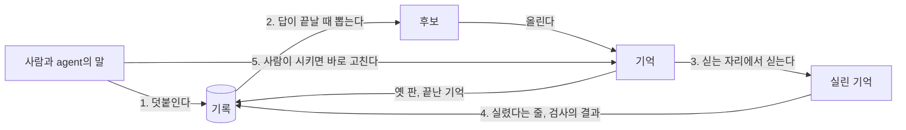

# 설계의 입구

기억 도구의 설계를 한 장에서 훑고, 자세한 글로 가는 길을 적는다. 제품은 두 모양이고 얹는 제품부터 만든다. 얹는 제품이 맡는 일은 이 글의 [두 모양](#두-모양)에 있고, 대신하는 제품이 갖추는 것은 아래 글 넷에 있다. 제품마다 달리 만들어 견주는 자리(제품 축), 조건을 붙여 미룬 것(뺀 것), 아직 정하지 않은 물음은 이 글의 표에만 있다.

만드는 순서와 견주는 법은 [판단과 방향](direction.md)에 있다. 이 글을 읽는 데 필요한 낱말은 아래와 같고, 나머지는 [용어집](../GLOSSARY.md)에 있다.

| 낱말 | 뜻 |
|---|---|
| 제품 | 같은 테스트셋으로 견주려고 만드는, 이 도구의 구현 하나다 |
| 얹는 제품, 대신하는 제품 | 얹는 제품은 기준선을 켠 채 두고 기억을 쓰는 일을 기준선에 맡긴다. 대신하는 제품은 기준선을 끄고 기록, 뽑기, 올리기까지 도구가 한다 |
| 기준선 | 견줄 때 기준으로 삼는, harness에 원래 들어 있는 기억 기능이다. 설계 글은 그 harness의 이름을 적지 않는다. 지금 기준선에 묶인 사실은 [Claude Code 동작](claude-code.md)에 있다 |
| 기록 | 도구가 대화에서 나온 말과 기억이 바뀐 일을 모두 덧붙여 남기는 층이다. 세션에 싣지 않는다 |
| scope, 세션의 대상 | scope는 기억이 쓰이는 곳이고, 대상(저장소, 일의 갈래, 사람, 기기)의 목록으로 적는다. 세션의 대상은 그 세션이 열린 저장소, 그 저장소가 속한 일의 갈래, 쓰는 사람, 기기다 |
| 싣는 자리 | 일하는 동안 harness가 반드시 지나가서 기억을 실을 수 있는 자리다. 세션이 시작할 때, 사람의 말이 들어올 때, 도구를 부르기 직전이 있다 |
| 근거, 기한 | 근거는 기억이 아직 맞는지 코드가 저장소에 대 보는 검사의 목록이다. 기한은 금방 바뀌는 사실을 적은 기억을 맞다고 보는 마지막 날이다 |
| 사람이 정한 기억 | 사람이 분명히 시켜서 정한 기억이다. "기억해", 고쳐 달라는 말, 되돌리기, 기억 파일을 직접 고친 것이 그렇다 |
| 검사 | agent가 실린 기억대로 하려는지를 도구를 부르기 직전에 대 보는 일이다 |

## 두 모양

기억을 누가 쓰느냐로 제품이 둘로 갈린다.

| 모양 | 도구가 하는 일 | 기준선에 맡기는 것 | 잃는 것 |
|---|---|---|---|
| 얹는 제품 | 실린 기억을 사람 화면에 보인다. 실렸다는 줄과 기억이 바뀌기 전의 판을 기록에 남기고, 바뀐 것을 알리며 되돌릴 수 있게 한다. 기억을 한 자리에 모아 다른 저장소에서 남긴 기억이 닿게 한다. 고친 기억의 옛 값을 품은 다른 기억을 찾아 모델에게 알린다 | 기억에 둘 말을 고르고 쓰는 일, 세션이 시작할 때 싣는 일, 사람의 말에서 고칠 기억을 찾아 고치는 일 | harness의 기억 기능에 기댄다. 그 기능이 바뀌면 같이 흔들리고, 기억 기능이 없는 harness에는 붙지 못한다. 사람이 정한 기억을 사람의 말로만 바뀌게 막지 않는다 |
| 대신하는 제품 | 기준선을 끄고 아래 [큰 그림](#큰-그림)의 한 바퀴를 모두 한다 | 없다 | 기록, 큐, 뽑기, 올리기, 다시 묶기를 모두 만들어야 한다. 도구의 모델이 기준선보다 못 뽑으면 기준선이 하던 것을 잃는다 |

| 판단 | 근거 | 다시 열 조건 |
|---|---|---|
| 얹는 제품부터 만들고, 얹는 제품으로 풀리지 않는 시험이 남을 때 대신하는 제품을 만든다. 얹는 제품을 넷째 장치까지 돌린 지금은 만들지 않는다 | 기준선을 테스트셋에 돌리니 기억을 쓰는 쪽의 시험은 열하나 가운데 아홉을 통과했다. 기준선이 못한 것은 다른 저장소에서 남긴 기억이 닿지 않는 것, 그 작업에서만 한 말이 기억이 되는 것, 다른 낱말로 적힌 낡은 기억을 놓치는 것이고, 사람에게 보이지 않는 것은 실린 기억과 바뀐 내력이다. 이 가운데 쓰기를 통째로 가져와야만 풀리는 것은 아직 보지 못했다. 얹는 제품을 넷째 장치까지 돌린 뒤 남은 실패는 둘이다. 사람이 부른 이름이 기억에 적힌 이름과 달라 모델이 고치기 전에 어느 기억인지 묻는 것은 기준선에서도 나오고 사람의 답 하나로 풀린다. 같은 폴더에서 연 다른 일에 그 폴더의 규정을 따른 것은 아홉 번 가운데 한 번이고, 답에서 맞지 않을 수 있다고 밝혔다. 기준선의 동작은 [원래 auto memory의 동작](claude-code/auto-memory.md)에 있다 | 기억을 쓰는 일을 도구가 가져와야만 풀리는 실패가 시험에서 드러날 때. 얹는 제품이 사람에게 알리지도 묻지도 않고 낡은 기억을 남기거나 맞지 않는 기억대로 하는 것이 그 후보다 |
| 기준선이 통과한 갈래의 장치는 얹는 제품에 넣지 않고, 들어올 조건과 함께 [뺀 것](#뺀-것)에 둔다 | 기준선이 이미 하는 일을 다시 만들면 도구가 모든 것을 처리하려 들고 구조를 읽기 어려워진다. 통과는 쉬운 조건에서 본 것이어서, 들어올 조건을 더 어려운 조건의 시험에서 기준선이 실패하는 일로 적는다 | — |

얹는 제품이 갈래마다 맡는 일은 아래와 같다. 만드는 차례는 [판단과 방향](direction.md)의 제품의 차례에 있다.

| 갈래 | 얹는 제품이 하는 일 |
|---|---|
| 보임 | 세션이 시작할 때 실린 기억을 사람 화면에 보인다. 색인이 잘렸으면 잘렸다고 알린다 |
| 닿음 | 기억을 한 자리에 모아, 다른 저장소에서 남긴 기억도 닿게 한다 |
| 끼어듦 | 기억마다 남긴 저장소와 어디서나 쓰이는지를 적게 해서, 한 곳에만 준 말이 다른 저장소에서 쓰이지 않게 한다. 그 작업에서만 한 말은 기억으로 쓰지 않게 한다. 지시 글은 [products/overlay](../products/overlay/memory-rules.md)에 있다 |
| measurement, 내력 | 기억마다 실렸다는 줄과, 바뀔 때마다 바뀌기 전의 판과 그때의 사람 말을 기록에 남긴다 |
| 한 곳 | 기억 파일을 폴더 하나에 둔다 |
| 고침 | 기억이 바뀐 답이 끝날 때, 바뀐 기억의 옛 값을 글자 그대로 품은 다른 기억을 모두 찾아 모델에게 알린다. 같은 사실인지 가려 고치는 일은 모델이 한다 |
| 기억이 맞다 | 기억이 바뀌면 알리고, 기록의 판으로 되돌릴 수 있게 한다 |
| 조용한 실패, 숨은 비용 | 실패와 쓴 양을 기록에 남기고 화면 한 줄로 알린다 |
| 따름 | 따로 하는 일이 없다. 기준선의 지시문에 맡긴다 |

얹는 제품의 기록은 대화의 말을 모두 담지 않고, 기억이 실린 일과 바뀐 일만 담는다.

## 큰 그림

대신하는 제품은 말을 모두 기록에 남기고, 그 가운데 다음 세션에 실을 것만 기억으로 삼는다. 아래는 대신하는 제품에서 말 하나가 기억이 되어 쓰이고 고쳐지기까지의 한 바퀴다. 이 절부터 [당기는 짝](#당기는-짝)까지는 대신하는 제품의 설계다.

| 걸음 | 일어나는 일 | 자세히 |
|---|---|---|
| 1. 말이 기록에 남는다 | 일하는 중에는 대화의 말을 기록에 덧붙이기만 한다 | [저장](design/storing.md)의 큐 |
| 2. 답이 끝날 때 뽑힌다 | 답 한 번이 끝나면 사람이 기다리지 않는 뒤쪽에서 쌓인 말을 처리해, 기억에 둘 만한 말을 후보로 뽑는다. 서로 다른 세션에서 되풀이되거나, 사람의 결정이 분명하다고 모델이 판정하거나, 사람이 "기억해"라고 하면 기억으로 올리고, 올라간 기억을 화면에 알린다. 처리하지 못한 말은 다음 세션이 시작할 때 이어서 처리한다 | [저장](design/storing.md)의 기억에 둘 것, 큐, 뽑기, 올리기 |
| 3. 세션에 실린다 | agent가 부르기를 기다리지 않고 싣는 자리에서 코드가 싣는다. scope가 세션의 대상과 겹치는 기억만 고른다. 어느 싣는 자리를 쓰는지는 제품 축이다 | [활용](design/using.md)의 싣는 자리, 고르기, 가까운 쪽 |
| 4. 실린 동안 쓰인다 | 실린 기억을 사람 화면에 보이고, 기억마다 실렸다는 줄을 기록에 남긴다. 실린 기억대로 하게 만드는 방식은 제품 축이고, 검사를 두는 제품은 그 결과도 기록에 남긴다 | [활용](design/using.md)의 화면, 따름, 쓰임 |
| 5. 사람의 말로 고쳐진다 | 사람이 고쳐 달라고 하면 뒤로 미루지 않고 바로 처리한다. 뽑을 때 붙여 둔 주제로 코드가 고칠 기억을 찾아 묻지 않고 고치고, 바뀐 것을 알린다. 새 판이 기억이 되고 옛 판은 기록에 남아서 되돌릴 수 있다 | [저장](design/storing.md)의 고치기와 되돌리기, 사람이 정한 것 |

판은 만들 도구 안에서 기억 하나의 한때 모습을 가리키는 말이고, 책의 개정판과 같다.

기억은 사람이 시키지 않아도 바뀐다. 뒤에 나온 말이 같은 주제의 다른 문장이면 기억이 고쳐지고, 근거가 어긋나거나 기한이 지난 기억은 싣지 않거나 끝낸다. 이때도 바뀐 것을 알리고 되돌릴 수 있게 한다. 사람이 정한 기억만은 사람의 말로만 바뀌고, 거기에 막힌 말은 후보로 남아 화면에 알린다. 규칙은 [저장](design/storing.md)의 다시 묶기, 낡음, 사람이 정한 것에 있다.

이미 쌓인 기억을 받는 걸음은 이 그림에 없고, [열어 둔 물음](#열어-둔-물음)에 있다.

| 글 | 담는 것 |
|---|---|
| [기억의 상태](design/state.md) | 뼈대. 기록과 기억의 두 층, 상태 넷(후보, 기억, 끝남, 실림), 전이, 칸, 검증 |
| [저장](design/storing.md) | 말이 기억이 되고, 고쳐지고, 끝나는 길 |
| [활용](design/using.md) | 기억이 세션에 닿아 쓰이는 길 |
| [비용](design/cost.md) | 불어나는 구조, 어림, 줄이는 규칙, 좁히기가 놓치는 자리, 재기 |

## 갈래와 글

쓰는 사람이 겪는 문제는 열한 갈래이고, 갈래마다의 원하는 것은 [README](../README.md)에 있다. 설계 글은 갈래가 아니라 길(뼈대, 저장, 활용, 비용)로 나눴다. 부품 하나에 갈래 여럿이 걸리기 때문이다. 싣기 하나에만 보임, 닿음, 끼어듦, 조용한 실패, 숨은 비용이 걸린다.

아래 표는 갈래마다 대신하는 제품이 갖추는 것과 그것이 적힌 글을 잇는다. 이 가운데 [뺀 것](#뺀-것)에 오른 장치는 대신하는 제품에도 들어올 조건이 드러난 뒤에 넣는다.

| 갈래 | 갖출 것 | 적힌 글 |
|---|---|---|
| 보임 | 실을 때마다 실린 기억의 개수, 출처, scope를 사람 화면에 보인다. 새로 올라간 기억, 바뀐 기억, 사람이 정한 기억에 막힌 말도 알린다 | [활용](design/using.md)의 화면, [저장](design/storing.md)의 올리기, 고치기와 되돌리기 |
| 닿음 | agent가 부르기를 기다리지 않고 싣는 자리에서 코드가 싣는다. 다른 저장소에서 남긴 기억도 scope가 맞으면 싣는다. 놓친 것은 사람이 단서를 말해 되찾는다 | [활용](design/using.md)의 싣는 자리, 고르기, 되찾기 |
| 따름 | 따르게 만드는 장치는 두지 않고 실린 글의 지시에 기댄다. 걸리는 기억만 실어 지시의 수를 줄이는 것이 받친다. 검사와 요약 뒤 다시 싣기는 뺀 것이다 | [활용](design/using.md)의 따름, 실림과 내리기 |
| 끼어듦 | scope가 세션의 대상과 겹치는 기억만 싣는다. 같은 주제는 가까운 쪽 하나만 싣는다. 후보, 끝난 판, 근거가 어긋나거나 기한이 지난 기억은 싣지 않는다 | [활용](design/using.md)의 고르기, 가까운 쪽 |
| measurement | 기억마다 언제 어느 세션에 얼마나 실렸는지가 사람의 표시 없이 기록에 남는다. 일이 나아졌는지는 테스트셋에서 기억을 켠 쪽과 끈 쪽을 견주어 잰다 | [활용](design/using.md)의 쓰임 |
| 내력 | 출처는 한 번 쓰고 바꾸지 않는다. 사람의 말에서 나온 기억은 원문 인용과 대화의 자리를 지닌다. 전이와 판은 모두 기록에 남는다 | [기억의 상태](design/state.md)의 칸과 기록, [저장](design/storing.md)의 뽑기, 한 곳과 내력 |
| 한 곳 | 기억은 사람이 읽는 markdown 파일로 한 자리에 두고, 기억마다 scope를 적는다 | [저장](design/storing.md)의 한 곳과 내력 |
| 고침 | 고칠 기억은 코드가 정한 길로 찾아 묻지 않고 고치고, 알리며, 되돌릴 수 있게 한다. 아무도 말하지 않은 낡음은 근거와 기한으로 잡는다 | [저장](design/storing.md)의 고치기와 되돌리기, 낡음 |
| 기억이 맞다 | 인용이 원문에 글자 그대로 있는지 코드가 대 보고, agent가 끌어낸 것은 이름표를 달아 사람의 말과 가른다. 사람이 정한 기억은 사람의 말로만 바뀐다. agent가 바꾼 것은 사람이 알 수 있고 되돌릴 수 있다 | [저장](design/storing.md)의 뽑기, 사람이 정한 것 |
| 조용한 실패 | 실패해도 일을 막지 않고, 사람 화면에 한 번 알리고, 기록에 남긴다. 싣는 글은 상한 안에 들게 짓고 덜어 낸 것을 알린다 | [저장](design/storing.md)의 실패, [활용](design/using.md)의 상한과 덜어내기 |
| 숨은 비용 | 비용을 세 몫으로 나눠 기억의 수와 기록의 길이에 붙는 몫을 구조로 끊는다. 세션마다 쓴 것을 세어 기록에 남기고 화면 한 줄로 보인다 | [비용](design/cost.md) |

내력, measurement, 조용한 실패, 숨은 비용은 따로 장치를 두지 않고 기록의 줄을 다르게 읽는다([기억의 상태](design/state.md)의 기록).

measurement의 원하는 것 가운데 "실린 뒤 그대로 했는지"는 검사를 두는 제품에서만 기록에 남는다. 검사는 뺀 것이어서 이 몫은 지금 비어 있다.

## 당기는 짝

갈래끼리 당기는 짝이 넷이다. 한쪽을 채울수록 다른 쪽을 잃는다.

| 짝 | 당기는 것 | 고른 것 | 남는 맞바꿈 | 적힌 글 |
|---|---|---|---|---|
| 닿음과 끼어듦 | 많이 실을수록 닿지만 그만큼 끼어든다 | scope로 좁혀 싣고, 좁혀서 생기는 놓침은 받아들이며, 놓친 것은 되찾기가 받친다 | 상한을 넘어 덜린 기억은 닿지 않을 수 있다 | [활용](design/using.md)의 고르기, 상한과 덜어내기, 되찾기 |
| 따름과 숨은 비용 | 따르게 하는 장치가 사용량과 기다림을 늘린다 | 따르게 하는 장치를 두지 않는다. 검사를 들인다면 모델을 부르지 않는 검사를 먼저 하고, 모델을 부르는 검사는 코드가 좁힌 호출에만 한다 | 지시가 많거나 대화가 요약으로 바뀐 뒤에는 따름이 흔들릴 수 있다 | [활용](design/using.md)의 따름, [비용](design/cost.md)의 줄이는 규칙 |
| 고침과 기억이 맞다 | 묻지 않고 고칠수록 사람 모르게 바뀐다 | 묻지 않고 고치되 알리고 되돌릴 수 있게 한다. 사람이 정한 기억은 사람의 말로만 바뀐다 | 사람이 정한 기억은 agent가 본 것이 사실이어도 사람이 말할 때까지 바뀌지 않는다 | [저장](design/storing.md)의 고치기와 되돌리기, 사람이 정한 것 |
| 보임과 숨은 비용 | 실린 것을 보일수록 context를 쓴다 | 모델에게 가지 않고 사람 화면에만 뜨는 길로 보인다 | 답의 어느 부분이 어느 기억에서 왔는지는 보이지 않는다 | [활용](design/using.md)의 화면 |

## 제품 축

아래 자리는 하나로 정하지 않고, 선택지마다 제품으로 만들어 같은 테스트셋으로 견준다. 앞의 둘은 얹는 제품과 대신하는 제품이 다르게 푸는 자리다.

| 축 | 선택지 | 견주어 가르는 갈래 | 갖출 것이 적힌 곳 |
|---|---|---|---|
| 그 작업에서만 한 말을 막는 법 | 기억을 쓰는 지시에 한 줄을 더한다(얹는 제품) / 후보로 받고 서로 다른 세션의 되풀이로 올린다(대신하는 제품) | 끼어듦, 기억이 맞다 | [저장](design/storing.md)의 올리기 |
| 고칠 기억을 찾는 법 | 옛 값을 글자 그대로 품은 기억을 모두 찾는다(얹는 제품) / 뽑을 때 붙인 주제로 찾는다(대신하는 제품) | 고침 | [저장](design/storing.md)의 고치기와 되돌리기 |

옛 값으로 찾는 길은 값이 없는 규칙에는 통하지 않는다. 모델이 첫 기억조차 고치지 않은 답에서도 찾을 옛 값이 없다. 사람이 부른 이름이 기억에 적힌 이름과 달라서 모델이 고치기 전에 되묻는 경우가 그렇다.

아래 넷은 대신하는 제품을 만들 때 견주는 축이다. 얹는 제품에서는 기준선이 하는 대로다.

| 축 | 선택지 | 견주어 가르는 갈래 | 갖출 것이 적힌 곳 |
|---|---|---|---|
| 싣는 때와 몫 | 세션이 시작할 때 걸리는 기억을 상한까지 한 번 / 세션이 시작할 때는 조금만 싣고 사람의 말마다 코드가 찾아 더 싣기 / 도구를 부르기 직전마다 | 닿음, 따름, 숨은 비용 | [활용](design/using.md)의 싣는 자리 |
| 같은 말을 알아보는 법 | 룰 / 주제의 다른 이름 / 모델. 주제를 얼마나 잘게 자르나도 여기서 견준다 | 고침, 기억이 맞다 | [저장](design/storing.md)의 뽑기 |
| 큐를 처리하는 문턱 | 쌓인 말이 얼마나 모였을 때 모델을 불러 뽑나. 답마다 바로 / 많이 쌓인 뒤 / 다음 세션이 시작할 때만 | 숨은 비용, 닿음 | [저장](design/storing.md)의 큐 |
| 기억이 지금 일에 걸리는 법 | 이 축은 선택지를 고르지 않는다. scope의 대상 목록으로 고르는 것이 갖출 것이고, 그것이 필요한지를 가리려고 둘과 견준다. 남긴 저장소가 곧 scope인 기준선, 그리고 scope로 막지 않고 모든 기억을 후보로 두어 관련도로 고르도록 따로 만드는 제품이다. 이 제품은 scope 밖의 기억을 점수만 깎는다 | 끼어듦, 닿음 | [활용](design/using.md)의 고르기 |

싣는 때를 견줄 때는 [비용](design/cost.md)의 어림 칸을 결과 곁에 함께 적는다.

## 뺀 것

지금은 넣지 않고, 들어올 조건이 시험이나 쓰는 중에 드러나면 들인다. 테스트셋의 뺀 것은 [판단과 방향](direction.md)에 있다.

앞의 여덟은 기준선이 그 갈래의 시험을 통과해서 뺀 것이다. 줄마다 기준선에서 본 것을 함께 적었고, 본 것은 쉬운 조건에서 세 번씩 돌린 결과다.

| 뺀 것 | 들어올 조건 | 닿는 글 |
|---|---|---|
| 따름의 검사. agent가 실린 기억대로 하려는지를 도구를 부르기 직전에 대 본다. 기억마다 둔 규칙에 명령을 대 보아 막는 프로그램 검사, 모델이 기억의 문장과 명령을 읽고 막는 모델 검사, 막지 않고 알리기가 있다. 막는 검사에는 사람이 자주 넘기는 검사를 내리는 장치가 따른다(Google Tricorder는 쓸모없다는 표시가 10% 이상인 분석기를 유예에 둔다). 기준선은 기억 하나를 30번째 요청까지 따랐다 | 지시가 많을 때나 대화가 요약으로 바뀐 뒤를 보는 따름의 시험에서 기준선이 실패할 때 | [활용](design/using.md)의 따름 |
| 근거와 기한으로 낡음을 잡기. 기준선은 근거가 되는 파일이 사라진 기억과 기한이 지난 기억을 그대로 따르지 않고 사람에게 되물었다 | 낡은 기억을 그대로 따라 틀리는 시험에서 기준선이나 제품이 실패할 때. 저장소를 읽기 전에 행동하는 경우가 그 후보다 | [저장](design/storing.md)의 낡음 |
| 가까운 쪽. 같은 주제의 기억이 한 세션에 여럿 걸리면 가장 가까운 scope의 하나만 싣는다. 기준선은 다른 저장소의 기억을 싣지 않아서 겹칠 일이 없었다 | 기억을 한 자리에 모은 제품이, 저장소의 사실과 다른 저장소에서 한 사람에 관한 말이 함께 실리는 시험에서 실패할 때 | [활용](design/using.md)의 가까운 쪽 |
| 되찾기의 전용 길. 사람의 단서로 모든 층을 찾아 사람이 고르는 다섯 걸음과, 사람이 쓴 낱말을 다른 이름으로 남기기다. 무엇으로 시작하는지(사람의 명령, agent가 부르는 정해진 도구, 사람의 말에서 알아채기)를 견주는 일도 함께 뺐다. 기준선은 색인에서 잘린 기억을 모델이 찾아 읽었다 | 기억을 한 자리에 모은 뒤에도 사람이 단서를 말했는데 찾지 못하는 시험에서 실패할 때 | [활용](design/using.md)의 되찾기 |
| scope의 대상 가운데 일의 갈래와 기기. 지금은 저장소와 사람만 쓴다. 기준선은 같은 폴더에서 연 다른 일의 세션 아홉 번 모두, 그 폴더에 남긴 직장의 규정대로 하지 않았다(적용하지 않는다고 밝히거나 사람에게 물었다). 기억마다 남긴 저장소를 적게 한 얹는 제품은 같은 장면 아홉 번 가운데 여덟 번 따를지 사람에게 물었고, 한 번은 맞지 않을 수 있다고 밝히며 그 규정대로 코드를 썼다 | 사람으로 넓힌 기억이 다른 일의 저장소에서 그대로 따라져 틀리는 시험에서 실패할 때 | [활용](design/using.md)의 고르기 |
| 실림과 내리기. 세션마다 실린 목록을 두어 다시 싣지 않기, 대화가 요약으로 바뀐 뒤 다시 싣기, 이어 여는 세션에 바뀐 기억만 싣기, 실린 기억이 끝나면 내리기다. 얹는 제품에서는 싣기를 기준선이 한다 | 대화가 요약으로 바뀐 뒤를 보는 따름의 시험에서 실패할 때 | [활용](design/using.md)의 실림과 내리기 |
| 사람이 정한 기억을 사람의 말로만 바뀌게 막기. hook이 기억 파일의 쓰기를 막고, 누가 정한 기억인지의 표시와 그 고침을 사람이 시켰는지의 판정을 둔다. 얹는 제품은 바뀐 것을 알리고 되돌릴 수 있게 하는 데까지만 한다. 기준선은 사람이 기억하라고 해서 남긴 기억이 저장소와 어긋났을 때 고치지 않고 사람에게 물었다 | 사람이 정한 기억이 사람의 말 없이 바뀌는 시험에서 기준선이나 제품이 실패할 때 | [저장](design/storing.md)의 사람이 정한 것 |
| 답과 기억의 연결. 답에 모델이 citation을 붙인다. 기준선은 물으면 기억에서 온 지적과 스스로 꺼낸 지적을 나눠 말했고, 근거로 실제 기억의 문장을 댔다(한 번씩 봤다) | 물어도 근거를 틀리게 대는 시험에서 실패할 때 | [활용](design/using.md)의 화면 |
| 사람이 고침을 받아들이거나 되돌린 내력을, 기억을 정리하는 모델에게 읽히기 | 되돌린 것을 거절로 남기고도 도구가 비슷한 잘못을 다른 문장으로 되풀이할 때 | [저장](design/storing.md)의 사람이 정한 것 |
| 왜 남았는지를 모델이 지어 적는 까닭 설명 | 원문과 계기만 읽어서는 왜 남았는지 알 수 없는 기억이 시험에서 나올 때 | [저장](design/storing.md)의 한 곳과 내력 |
| 같은 값을 여러 기억에 베껴 두지 않기. 베껴 두지 않으면 파일 하나만 읽어서는 값이 보이지 않을 수 있다 | 옛 값으로 찾아도 고칠 기억을 놓치는 일이 시험에서 드러날 때 | [저장](design/storing.md)의 고치기와 되돌리기 |
| 합치지 않고 scope의 대상마다 기억을 복사해 두기. 지금은 같은 문장이 여러 저장소에서 나오면 한 기억으로 합친다. 복사하면 규칙이 단순해지고 싣는 결과는 같지만, 고칠 곳의 수와 기억의 수가 는다 | 합친 기억 때문에 한 저장소의 고침이 다른 저장소의 몫을 잘못 바꾸는 일이 시험에서 드러날 때 | [저장](design/storing.md)의 다시 묶기 |
| 도구가 뒤에서 스스로 하는 정리가 비슷한 주제의 기억을 넓게 견주기. 큐를 처리할 때 일하는 길 밖에서 하고, agent가 정한 기억은 합치고 알리며 사람이 정한 기억은 알리기만 한다 | 주제가 둘로 갈려 고침이 빠지는 일이 시험에서 드러날 때 | [비용](design/cost.md)의 좁히기가 놓치는 자리 |
| 넓은 scope의 기억이 한 저장소에서만 맞지 않을 때, 그 저장소에 "여기서는 쓰지 않음"이라는 표시를 따로 두기. 지금은 실을 때마다 근거로 거른다 | 근거의 검사가 돌지 못해 모름으로 실린 기억이 시험에서 틀린 답을 낼 때 | [저장](design/storing.md)의 낡음 |
| 임시로 넘기는 말("다음 세션에서 살펴볼게")을 기록이 다음 세션에 한 번 전하기. 넘기는 말에 표시만 달고, 같은 저장소의 다음 세션이 시작할 때 한 번 보인 뒤 끝낸다. 기억의 상태를 거치지 않아서 기억이 늘지 않는다 | 테스트셋에 세션을 넘겨 이어 하는 시험을 더하고, 기준선이나 제품이 그 시험에 실패할 때 | [저장](design/storing.md)의 기억에 둘 것 |
| 기록을 모델로 요약하기 | 기록을 찾아 읽기 어려울 만큼 커질 때 | [비용](design/cost.md)의 줄이는 규칙 |
| 기억을 만드는 모델 고르기 | 뽑기의 판정이 시험에서 자주 틀릴 때 | [저장](design/storing.md)의 기억에 둘 것 |
| DB와 viewer. 원본은 markdown으로 두고 viewer는 보조로만 쓴다 | 파일을 바로 열어서는 찾기 어려울 만큼 기억이 많아질 때 | [저장](design/storing.md)의 한 곳과 내력 |
| 기기 사이 동기화. 기억을 둔 폴더를 git 저장소로 맞추는 길이 있다 | 기기 둘에서 같은 기억을 쓸 때 | [저장](design/storing.md)의 한 곳과 내력 |
| 대화 하나만 기억 끄기. 그 세션의 싣기와 뽑기를 끄고 기록은 남긴다. 넣지 않은 까닭은 둘이다. 다른 맥락이 끼어드는 것은 scope와 가까운 쪽이 막고, 이번 대화에서만 한 지시는 한 세션 안의 되풀이여서 기억이 되지 않는다 | scope와 가까운 쪽을 갖춘 제품을 돌린 뒤에도 사람이 일마다 기억을 쓰지 말라고 붙이는 일이 생길 때 | [활용](design/using.md)의 고르기 |
| 쓰임을 고르는 순서에 되먹이기와 사람의 helpful 표시 | 상한을 넘어 덜어내는 일이 실제로 생기고, 덜어낼 순서를 scope와 근거만으로 정할 수 없을 때 | [활용](design/using.md)의 쓰임 |
| 따로 지은 요약 한 장을 늘 싣기 | 걸리는 기억이 상한을 자주 넘어 덜어내는 일이 잦을 때 | [활용](design/using.md)의 상한과 덜어내기 |
| 뜻으로 찾는 검색 | 글자 그대로 찾기와 BM25로는 다른 말로 부른 기억을 찾지 못하는 일이 시험에서 되풀이될 때 | [활용](design/using.md)의 되찾기 |
| 기억을 싣는 층 견주기. 같은 기억을 harness가 원래 읽는 지시 파일에 싣는 제품과 싣는 자리에서 넣는 글로 싣는 제품. 겨누는 것은 추정 하나다. 도구 출력처럼 들어온 글을 모델이 지시보다 낮게 둔다는 것이고, 기억을 실은 자리마다 잰 연구는 찾지 못했다 | 싣는 자리에서 넣은 글로 실은 제품이 긴 세션의 뒤쪽에서 따름의 시험에 떨어질 때 | [활용](design/using.md)의 따름 |
| 다른 길로 붙기. 지금 길은 harness가 반드시 지나가는 자리에 코드를 붙이는 것이다. 다른 길은 harness가 원래 읽는 지시 파일에 기억을 써 두기, MCP server, 그리고 이 길들을 섞기다. MCP server는 agent가 부를 때만 돌고, 도구 설명이 요청마다 token을 쓴다. 섞는다면 자리를 내주는 harness에서는 지금 길을, 내주지 않는 harness에서는 지시 파일을 쓰고, MCP server는 파고드는 보조 길로 둔다 | 처음 붙인 harness 밖의 harness를 들일 때. 그 harness가 내주는 자리는 그때 그 문서에서 본다 | [활용](design/using.md)의 붙는 층 |
| 싣는 코드를 자리마다 띄우지 않고, 계속 떠 있는 프로그램 하나에 묻기 | 기준선을 돌릴 때 잰, 싣는 코드가 한 번 뜨는 시간이 일을 느리게 할 만큼 클 때 | [비용](design/cost.md)의 줄이는 규칙 |

## 열어 둔 물음

아직 정하지 않은 것이다. 제품 축은 견주어 가리고, 나머지는 볼 때가 오면 정한다. 아래는 얹는 제품을 만들며 볼 물음이다.

| 물음 | 지금 | 볼 때 |
|---|---|---|
| 기억을 쓰는 지시를 어디에 싣나 | 사람의 지시 파일에 실어 돌렸다. hook이 넣는 글로 싣는 쪽은 돌려 보지 않았다 | 지시 파일에 실은 지시가 긴 세션이나 지시가 많은 곳에서 따라지지 않는 것이 시험에서 드러날 때 |
| 폴더 하나에 모으면 색인 하나에 모든 저장소의 기억이 섞여 상한에 더 빨리 닿는다 | scope 표시가 색인 줄마다 붙어 세션이 시작할 때 실리는 글이 얼마나 느는지만 쟀다([비용](design/cost.md)의 재기). 여러 저장소의 기억이 섞인 색인은 돌리지 않았다 | 한 자리에 모은 제품을 여러 저장소의 기억이 많은 조건으로 돌릴 때 |
| 폴더 하나에 모으면 두 저장소가 같은 주제의 기억에 같은 파일 이름을 쓴다 | 모델이 다른 저장소에서 같은 주제를 기억할 때 앞 저장소의 파일을 덮어쓰는지는 보지 않았다. 본 것은 시험을 차릴 때다. 같은 이름의 두 기억을 한 폴더에 심자 뒤의 것이 앞의 파일을 덮어써서, 심을 때 이름을 달리 준다 | 두 저장소에서 차례로 같은 주제를 기억하게 하는 시험에서 앞 저장소의 기억이 사라질 때 |
| 기준선이 세션 밖에서 기억 파일을 바꾸는 일이 있나 | 모른다. 본 것은 모델이 파일 도구와 shell 명령으로 바꾼 경우뿐이다. 얹는 제품은 기억 폴더를 기록과 견주어 잡으므로 바꾼 길은 가리지 않지만, 세션 밖에서 바뀐 것은 계기를 적지 못한다 | 계기 없이 바뀐 기억이 기록에 쌓일 때 |
| 얹는 제품이 다른 harness에서 무엇이 되나 | 보지 않았다. 기억 기능이 없는 harness에는 얹을 것이 없다 | 처음 붙인 harness 밖의 harness를 들일 때 |

아래는 대신하는 제품이나 뺀 것을 들일 때 볼 물음이다.

| 물음 | 지금 | 볼 때 |
|---|---|---|
| 받기. 이미 쌓인 기억을 어떤 상태와 칸으로 받나 | 설계하지 않았다. 테스트셋의 지어낸 기억도 제품마다 받는 걸음을 거친다 | 첫 제품을 만들 때 |
| 후보의 만료 기간 | 정하지 않았다 | 기준선과 제품을 돌려 본 뒤 |
| 기록의 수명 | 비용 때문에는 두지 않는다. 짧게 두면 되찾기를 잃는다 | 읽기 쉬움이나 개인정보가 문제가 될 때 |
| 바뀜을 기록에 남기는 줄의 형식 | 줄에 누가, 언제, 어느 전이를 했는지가 들어간다는 것만 정했다. 후보는 git commit, 기록의 한 줄, 까닭을 필수 칸으로 두기다. 옛 판과 새 판을 어떻게 잇는지도 함께 정한다 | 제품을 만들 때 |
| 저장소가 어느 일의 갈래에 속하는지를 어디에 적나 | 정하지 않았다. 저장소마다 파일 하나에 적어 사람이 볼 수 있게 하는 안이 있다. 그러면 새 저장소에서 처음 한 번 정해야 한다 | 일의 갈래를 정하는 지름길을 만들 때 |
| 일이 문장의 일부에만 닿아 문장을 조각으로 나눌 때 무엇부터 자르나 | 안이 하나 있다. 닿지 않은 조각은 scope를 통째로 지키고, 닿은 조각만 대상으로 한 번 더 자른다. 그러면 한 번에 조각이 셋을 넘지 않는다. 반대 순서로 자르면 닿지 않은 조각까지 대상마다 갈라진다. 주제도 조각을 따라 나뉜다. [검증 도구](../tools/state-check/README.md)에는 넣지 않았다 | 제품을 만들 때 |
| 같은 말을 무엇으로 알아보나, 주제를 얼마나 잘게 자르나, 기억 하나가 주제 둘에 걸릴 때 | 제품 축 "같은 말을 알아보는 법"으로 견준다 | 견준 뒤 |
| 주제의 다른 이름을 어디에 두나, 그 목록을 누가 고치나, 목록에 없는 낱말이 나오면 어떻게 하나 | 정하지 않았다. 한 곳의 목록에 두는 것은 "같은 말을 알아보는 법"의 선택지다. 되찾기에서 사람이 쓴 낱말이 더해진다는 것만 정했다 | 위 물음과 함께 |
| 기억의 문장을 고칠 때 그 기억에 붙은 근거와 검사의 규칙을 어떻게 함께 고치나 | 근거는 고칠 때 다시 적는다. 검사의 규칙은 정하지 않았다. 문장은 고쳤는데 규칙은 옛 값을 요구하는 일이 생길 수 있다 | 검사를 두는 제품을 만들 때 |
| 기억 파일 머리의 칸이 바뀌면 이미 쓴 기억을 어떻게 옮기나 | 정하지 않았다 | 칸을 바꿀 때 |
| scope 없이 관련도로 고르는 제품이 scope 밖의 기억에서 점수를 얼마나 깎나 | 정하지 않았다 | 그 제품을 만들 때 |
| 뽑는 자리에서 근거의 검사가 돌지 못할 때 제안된 근거를 남기나 | [검증 도구](../tools/state-check/README.md)는 남기고, 처음 실을 때 판정한다 | 제품을 만들 때 |
| 지금 상태를 적은 기억의 기본 기한 | 값을 정하지 않았다 | 기준선과 제품을 돌려 본 뒤 |
| 낡음의 검사가 끝낸 기억을 사람이 되돌렸을 때 그 근거를 어떻게 하나 | 다시 끝내지 않되, 근거가 어긋나는 동안에는 싣지 않는다 | 그 경우가 시험에서 나올 때 |
| 사람이 정한 기억에 막힌 말을 화면에 몇 번 알리나 | 정하지 않았다. 실패를 알리는 규칙(한 번, 풀리지 않았으면 다음 세션이 시작할 때 한 번 더)과 같게 하는 쪽을 권한다 | 제품을 만들 때 |
| 사람이 되돌린 scope가, 그 되돌리기로 물러난 기억의 scope보다 좁을 때 거절의 표시를 어디에 남기나 | [검증 도구](../tools/state-check/README.md)는 물러난 기억을 통째로 끝내고 거절의 표시를 남기지 않는다 | 제품을 만들 때 |
| remote가 없는 저장소를 무엇으로 알아보나 | 정하지 않았다 | remote가 없는 저장소에서 일하는 일이 생길 때 |
| 덜어낼 때 무엇부터 덜지 | 정하지 않았다 | 제품을 만들 때 |
| 후보도 사람 화면에 보이나 | 사람이 정한 기억에 막힌 말의 후보만 알린다. 그 밖의 후보는 정하지 않았다 | 제품을 만들 때 |
| 막는 검사를 사람이 넘긴 것을 무엇으로 세나, 몇 번부터 어느 비율에서 내리나, 내린 뒤에는 어떻게 되나 | 정하지 않았다. 활용 글은 사람의 표시를 기억이 틀렸다는 표시 하나만 받는다 | 검사를 두는 제품을 만들 때 |
| 기록에 남은 실패를 사람이 모아 보는 화면 | 실패를 기록에 남기는 데까지만 정했다 | 제품을 만들 때 |
| 큐를 처리하는 문턱의 값 | 제품 축으로 견주고, 값은 정하지 않았다 | 기준선을 돌릴 때 |
| 뒤에서 띄운 처리가 세션이 닫힌 뒤에도 살아남나 | 모른다. 기준선의 문서는 대화 없이 도는 세션에서는 끝날 때 죽인다고 적고, 대화형 세션은 적지 않는다([Claude Code의 구조와 동작](claude-code/structure.md)). 죽어도 처리하지 못한 말은 다음 세션이 시작할 때 이어서 처리한다 | 기준선을 돌릴 때 |
| 근거로 든 파일이 제자리에 없을 때 다른 자리에서 한 번 찾아보는 일이 실을 때마다 드는 시간 | 재지 않았다. 크면 찾은 결과를 적어 두는 길을 본다 | 기준선을 돌릴 때 |
